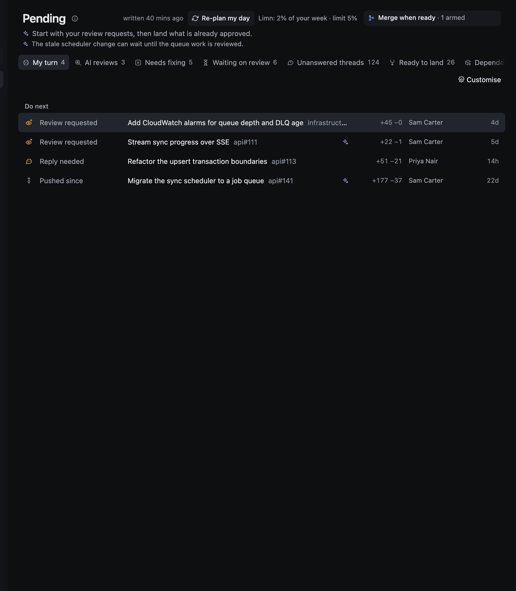
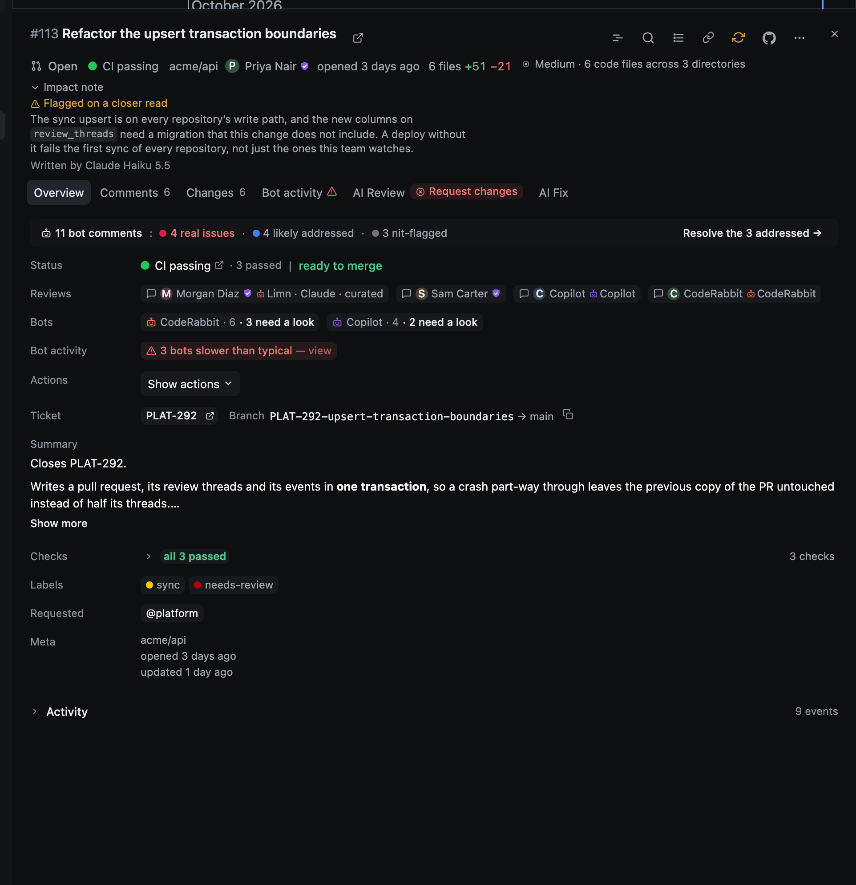
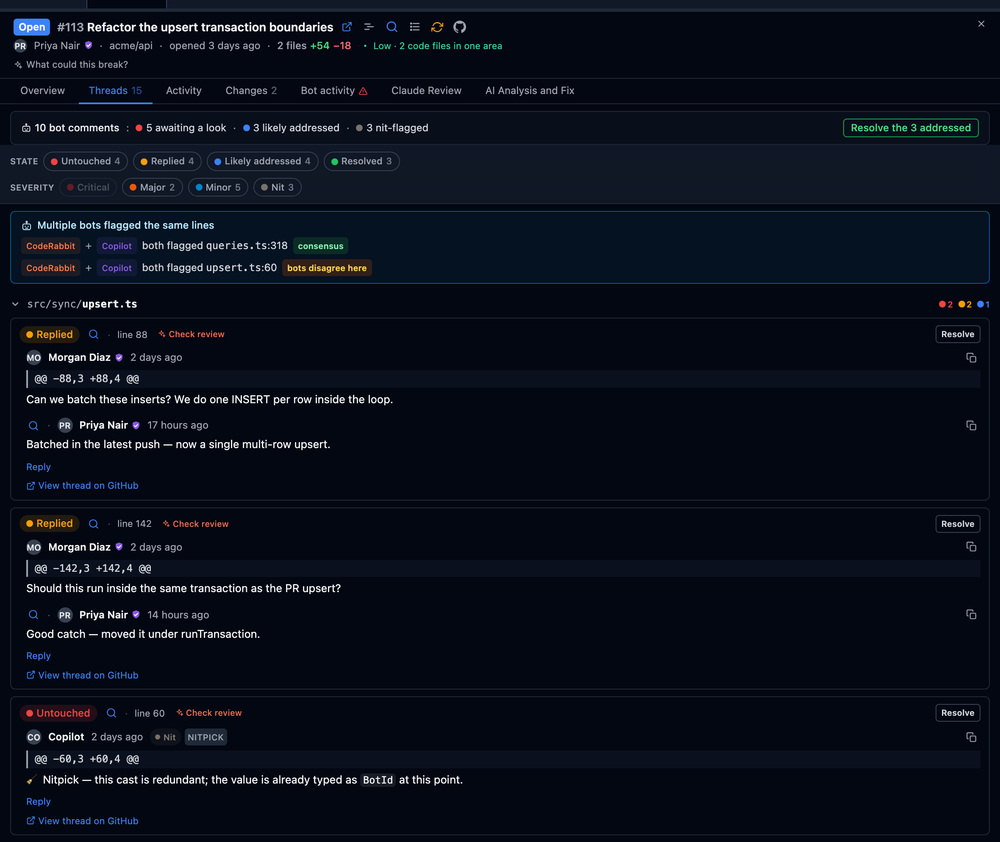

# Limn (`limn-review`)

**The calm layer above your review bot.** Bring your own reviewer — CodeRabbit,
Greptile, Copilot, whatever you run — and Limn becomes the cross-repo triage
layer *above* it: what's stalled, whose turn it is, and which of the bot's comments
a human still needs to read. A single-page dashboard for a whole team's GitHub
activity across many repos: a horizontal timeline per repo, member sub-lanes, and
drill-down into PRs and review threads (read them in-app).

Third-party review-bot output (CodeRabbit · Greptile · Copilot · Qodo · Sourcery)
is a **first-class, triaged signal**, not generic noise: bot threads a later commit
has likely addressed vs the ones still needing a human, a per-vendor signal-to-noise
rate, and one-click bulk-resolve of the stale ones. **Claude Review** and **AI Fix**
run on your own Claude Code login or Anthropic API key — see
[Review and fix with Claude](#review-and-fix-with-claude).

Repos are organised into **Workspaces** — a named group of repos, and the one scope
the whole app runs on. Every repo lives in exactly one workspace (new repos land in
**Default**, which you can rename but not delete), so switching workspace re-scopes
the feed, the timeline, the metrics and the review-bot settings together. Reports
can compare workspaces side by side once you have more than one.

Limn runs **only on your machine**: SQLite, your `gh` CLI for GitHub, no accounts and
no hosted backend. `npx limn-review` opens straight to the app. Every feature is
free (see [License](#license)). (The package was `pierre-review`; that name is
deprecated, and `~/.pierre-review` moves to `~/.limn` once, on first boot.)

> **Try the demo — [limn-review.com/demo/](https://limn-review.com/demo/)**
> The real app in your browser, on sample data. Nothing is sent anywhere.

## Screenshots

Pending — everything waiting on you or your workspace, across every repository, in
seven ranked tabs:



Drill into any PR without leaving the dashboard — review threads grouped by file,
each tagged with its derived state (resolved · replied · likely-addressed ·
untouched), alongside CI, approvers, and the full activity feed:



Every review thread already triaged, and every bot comment graded for severity:



## Prerequisites

- Node ≥ 20 (developed on 24)
- pnpm ≥ 9 (from a checkout)
- GitHub CLI (`gh`) authenticated: `gh auth login`. For org repos behind SSO you
  may need `gh auth refresh -h github.com -s read:org`.

## Quick start

To use it: `npx limn-review`. To work on it, from a checkout:

```bash
pnpm install
cp .env.example .env        # optional; sensible defaults otherwise
pnpm db:migrate             # create the SQLite schema (also runs on startup)
pnpm dev                    # backend :4000 + frontend :5173
```

Open http://localhost:5173. Add repos from the UI (owner/name); the first sync
backfills the last 90 days, then each repo is re-synced as often as its activity
warrants.

By default bulky text (PR descriptions, diff hunks, commit messages) isn't stored —
it's fetched from GitHub when you open a PR and cached in the browser, keeping the DB
small and backfills fast. Set `PERSIST_BODIES=true` to store it locally (larger DB,
PR detail works fully offline).

### One-off sync without the server

```bash
pnpm sync:once owner/repo
pnpm db:studio              # inspect the data
```

## Review and fix with Claude

Every pull request gets a **Claude** tab. It is on by default — there is no flag to
set. It runs on Claude or on Codex (see [Codex instead of Claude](#codex-instead-of-claude)).

- **Claude Review** — Claude reads the change and returns findings, each tied to a
  line. Tick the ones worth keeping and post them as **one** GitHub review. Paste in
  a story and it checks the change against it. **Auto review** reviews new pull
  requests as they arrive; it is off for every workspace until you switch it on.
- **Ask Claude** — a chat on the review, and on each finding.
- **AI Fix** — pick the review comments you want fixed. It edits a copy of the
  branch, shows you the diff, and pushes only when you click Push.

What the agents can do:

- The reviewer (and the chat) reads the code. It cannot edit files, run commands or
  reach the web.
- The fixer edits files. It has no shell, so it builds and tests nothing.
- Nothing is posted or pushed until you press the button.

With an issue tracker connected (Jira, GitHub Issues or Linear, in Settings), a
review can fill its story from the linked ticket, auto review included. Without one,
paste the story in.

### Your Claude, not ours

It runs on your own Claude Code login or Anthropic API key. Limn stores no key and
charges nothing for it. Every AI feature (reviews, fixes, chats, report write-ups)
uses the same two sources, first one wins:

1. **Your Claude Code login** — run `claude` once to sign in (or set
   `CLAUDE_CODE_OAUTH_TOKEN`). A run on the login never sees `ANTHROPIC_API_KEY`.
2. **`ANTHROPIC_API_KEY`** in the environment.

Set `LIMN_AI_USE_API_KEY=true` to use the key even when you are signed in. With
neither, the Run button is replaced by one line: *Sign in to Claude Code or set
ANTHROPIC_API_KEY*. The ladder lives in `apps/backend/src/ai/credentials.ts`.

### Codex instead of Claude

Every AI feature can run on Codex instead, on your own ChatGPT plan. One provider runs
everything at a time.

Codex comes with Limn (see One-time setup below). Sign in from **Settings → AI**, or:

```bash
npx limn-review ai login codex     # sign in with ChatGPT (add --device-auth on a headless machine)
```

Limn keeps its own Codex
sign-in in `~/.limn/codex`; your `~/.codex` is not read or changed. Codex with an
OpenAI API key is not available yet.

Pick the provider in **Settings → AI**, or set `LIMN_AI_PROVIDER` to `claude`, `codex`
or `auto` (the default: Claude when both are signed in, Codex when only Codex is).
Each run is labelled with the provider and model that ran it. On Codex the models are
`gpt-6.1-sol` (deep reviews), `gpt-6.1-terra` and `gpt-6-luna`. The rules are the same:
no shell, no web, and nothing posted or pushed until you press the button. The spend
budget counts Limn's share of your ChatGPT plan's 5-hour and weekly limits.

### One-time setup

Claude and Codex both work out of the box. The npm package ships no AI SDKs, so
`npx limn-review` stays small; the first time Limn starts, it downloads both in the
background (Claude about 110 MB, Codex about 360 MB unpacked) while you use the rest of
the app. Its progress shows where the Run buttons will be, with **Retry** if it fails.
Signing in to Claude Code or Codex is the only step.

To run the download yourself, or again:

```bash
npx limn-review ai install codex   # Claude and Codex; `ai install` alone is Claude only
```

This installs exact, pinned versions of the Claude Agent SDK and its peers, and the
Codex CLI, into `~/.limn/ai-runtime`. Set `LIMN_AI_AUTO_INSTALL=false` to skip the
automatic download (`LIMN_AI_DISABLED=true` skips it too). From a checkout (`pnpm dev`) they resolve from `node_modules`
and there is nothing to install. To use the `claude` you already have installed
instead of the bundled one, set `LIMN_CLAUDE_PATH=/path/to/claude`.

To hide every AI surface, set `LIMN_AI_DISABLED=true`.

## Bot-comment severity

Review-bot comments can be scored for **severity** (nit → critical) and **category** by a
small ML model, with badges on each comment and a rollup on the Bots tab. It uses no LLM
and costs nothing. The model runs inside Limn, at background priority. The first time,
press **Set up** in the app (a one-time download of about 240 MB), or run:

```bash
npx limn-review ml install     # or `limn ml install`
```

From a checkout, `pnpm dev` reads the model from the `packages/ml` submodule.
`LIMN_ML_DISABLED=true` turns scoring off. Full setup, tuning and caveats:
[docs/ML-SEVERITY.md](docs/ML-SEVERITY.md).

## Demo and website

- `pnpm --filter @pierre-review/frontend build:demo` builds the static demo — the real
  app on recorded sample data — into `apps/frontend/dist-demo/`, served at `/demo/`.
  See [apps/frontend/src/demo/README.md](apps/frontend/src/demo/README.md).
- `apps/site` is the small service behind limn-review.com: the landing pages, the
  demo and the contact form. See [apps/site/README.md](apps/site/README.md).

## Layout

- `apps/backend` — Fastify API, Drizzle + SQLite, the GitHub sync engine; reporting,
  Bots Monitoring and Slack live in `src/platform/`
- `apps/frontend` — React + Vite + Tailwind + vis-timeline dashboard (served at `/app`),
  plus the static demo runtime in `src/demo/`
- `apps/landing` — the marketing pages (prerendered; served by `apps/site`)
- `apps/site` — the website service (landing, `/demo/`, contact form)
- `packages/shared` — the contract shared by both sides
- `packages/ml` — the bot-comment severity model (submodule)

See `CLAUDE.md` for the architecture and conventions.

## License

Limn is **source-available** under the [Limn License 1.0](./LICENSE).

- **Free** for individuals, and for any team or organisation where **3 people or
  fewer** use it. You may use, copy and change it.
- **More than 3 people** in one organisation (affiliates count together) need a
  commercial licence — ask through the
  [contact form](https://limn-review.com/contact).
- You may **not** offer Limn, or a product built from it, as a competing
  commercial product or service.
- Copies you pass on must keep the licence and copyright notice.

The licence does not convert to MIT or any other licence over time.
