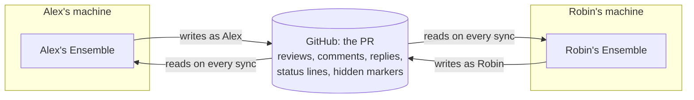
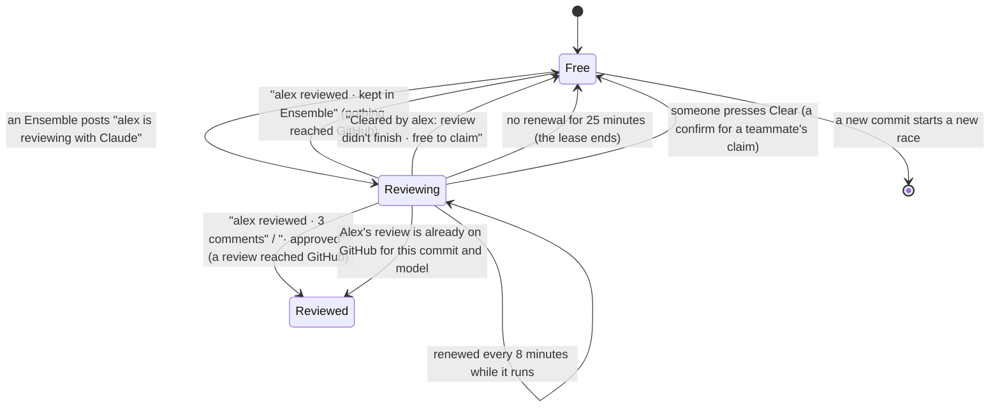
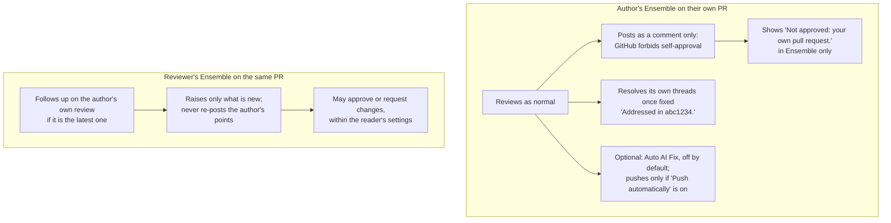
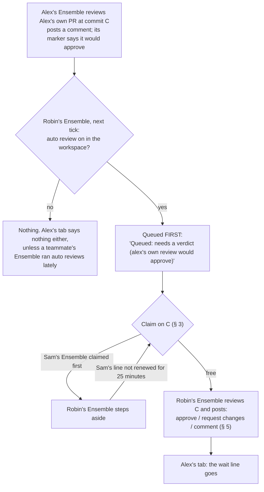
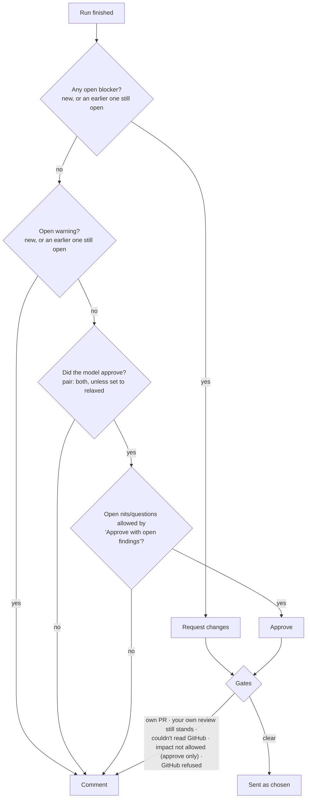
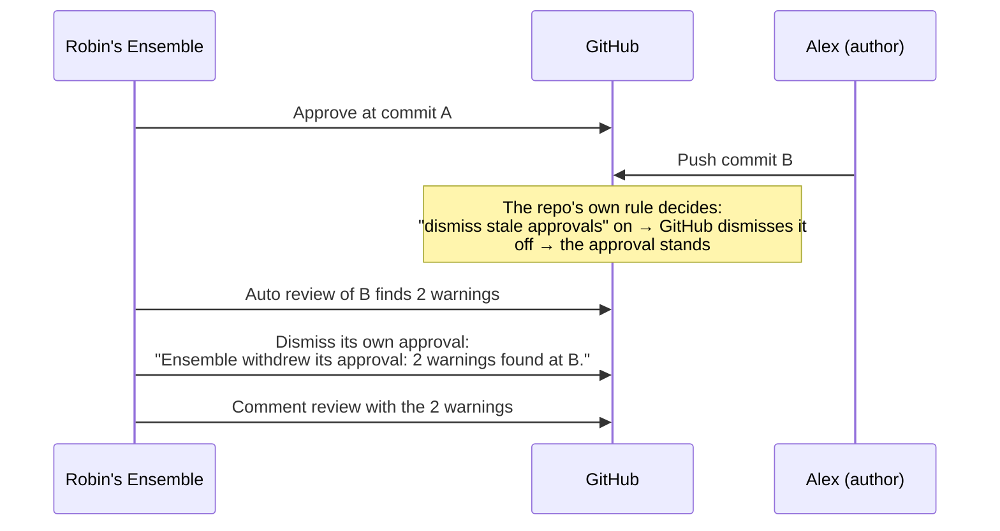
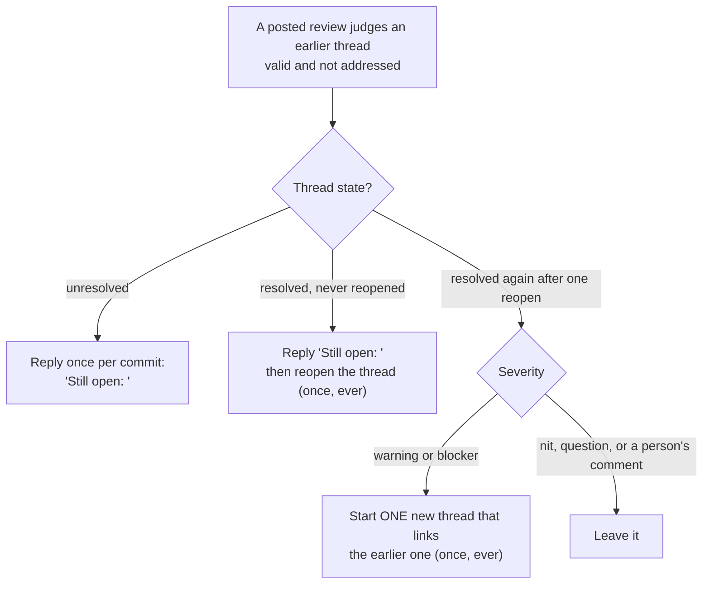
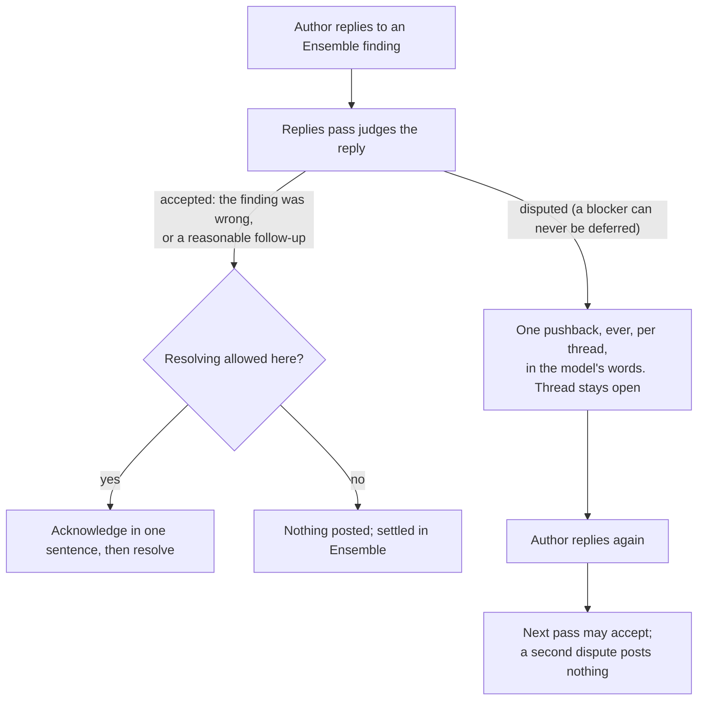

# Ensemble on a team: how shared reviews work

**Status:** the design reference for every multi-user behaviour. A shareable copy with drawn
diagrams lives in Claude Docs ("Ensemble on a team: how shared reviews work"); this file is the source. Checked against the code on
2026-11-05 (Ensemble 1.0.5); § 4 "A teammate's verdict" and § 3's catch-up on 2026-11-10; claims, resolving
Ensemble's threads and lifting a teammate's block made always on (no settings) on 2026-11-10; dependency
claims (§ 3 Dependency updates) on 2026-11-14; the story check's own claim (§ 3 The story check's own claim)
on 2026-11-23. **Keep it true:** any change to claims, auto review, auto-posting, verdicts,
withdrawals, teammate reviews, thread judgements, replies, pushback, resolving or still-open points
updates this file in the same commit — so does any change to the dependency automation's claims. Engineering detail (names, tables, markers) lives in
[CLAUDE-REVIEW.md](CLAUDE-REVIEW.md); this file says what happens and why, in plain words.

---

## 1. The idea in one page

Every person runs their own Ensemble on their own machine, signed in to GitHub as themselves. There is
no Ensemble server and no shared account. **GitHub is the only meeting place**: each Ensemble reads what
the others wrote there, and writes back only as its own person.

Three rules follow from that and explain most of what is below:

1. **An Ensemble only knows what reached GitHub.** A review someone "kept in Ensemble" is invisible to the team.
2. **Every write is a person's write ON GITHUB, and Ensemble's IN ENSEMBLE.** An Ensemble post is that person's
   review or comment on GitHub, so GitHub's own rules apply to it (an author cannot approve their own
   PR; branch rules decide what a push dismisses). Inside Ensemble it is the bot "Ensemble · alex", never
   alex: the owner's rule is "everything Ensemble does on my behalf is not me". Every row Ensemble wrote
   (a review, an approval, the empty review around a reply, a story check, a commit, a merge, a PR it
   opened) is stored under that bot, recognised by the hidden marker, the `Ensemble-Run:` commit trailer,
   or, on the machine that wrote it, Ensemble's own record of its writes ([CLAUDE-REVIEW.md](CLAUDE-REVIEW.md)
   § Ensemble's actions are bots). A teammate's Ensemble rows are found by the marker and the trailer only.
3. **Each Ensemble decides alone, from what it reads.** Nothing coordinates two machines except the
   status lines and markers they leave on GitHub, so every rule is written to be safe when two Ensemble installs
   act at nearly the same moment, and safe when a teammate runs an older version.

What travels between Ensemble installs:

| Signal on GitHub | What it tells another Ensemble |
|---|---|
| A **status line** on the PR's latest commit, one per model ("alex is reviewing with Claude", "alex reviewed · 3 comments", "Cleared by alex…") | Who is reviewing this commit with which model, and whether it is done. Never CI. Named `ensemble/review-claude` / `ensemble/review-codex`; a teammate's older `limn/` lines are read the same (§ 12). |
| A **posted review** with a hidden marker at the end | That it is an Ensemble review; the commit it read; the model(s); the verdict sent; the Ensemble version; its judgement of earlier threads; whether the poster lets a teammate's Ensemble lift their "changes requested"; on the poster's own PR, the verdict their Ensemble would have sent (§ 4). |
| **Finding comments** with a severity word ("**Warning**") and a hidden marker | An Ensemble finding, raised by that person's Ensemble. Every Ensemble treats it as a bot ("Ensemble · alex"), never as the person. |
| An **`Ensemble-Run:` line** at the end of a commit message | A commit Ensemble made (AI Fix, a conflict resolution, Implement, a branch update). Every Ensemble treats it as the bot's, never the person's. |
| **"Still open:" replies** with a hidden marker | Which commit it was said at, and whether this thread has already been reopened once. |
| An **`ensemble/story-check` line** on the latest commit of each of a ticket's open PRs ("alex is checking the story", "alex checked the story · 3 gaps") | Who is checking this ticket's story at these commits, and whether it is done. Separate from the review lines, so a teammate without story checks never holds it (§ 3 The story check's own claim). Never CI. |
| An **`ensemble/build` line** on the head of a ticket's branch ("alex is building PAY-142") | Someone is building that ticket with Implement or Fill gaps: the story view shows who instead of the button (§ 3 Implement and Fill gaps). |

What never travels: costs, settings, drafts, reviews kept in Ensemble, chat, and anything about the
reader's machine. (Code and diffs do go to the model provider the person chose; that is not shared
with teammates.)

---

## 2. Who is who

| Word | Meaning |
|---|---|
| **Author** | The person who opened the PR. GitHub never lets them approve it or request changes on it. |
| **Reviewer** | Anyone else on the team looking at the PR. |
| **Reader** | Whoever is looking at Ensemble right now. Each person is the reader on their own machine. |
| **Your Ensemble / Robin's Ensemble** | The Ensemble running for that person, posting as them. |
| **Model** | Claude or Codex. Each person signs in to their own; usage limits are per person. |
| **Pair** | A review where Claude and Codex both review blind and Ensemble merges them into one post. The default when both are signed in. |
| **Auto review** | A review Ensemble starts by itself. Off per workspace until switched on. |
| **Posting** | Sending a review to GitHub. Automatic runs post by default (the "Post to GitHub" setting); a run you start posts only with "Review and post". |

---

## 3. Sharing the review burden

**The rule: one review per model per commit, across the whole team.** If Robin's Ensemble reviews a
commit with Claude, nobody else's Ensemble reviews that commit with Claude. Another model is still
welcome: if Robin used Claude, Alex's Ensemble reviews with Codex only. If Robin ran both, Alex's runs
nothing. A new commit starts the race again.

Only **automatic** reviews claim. A review you start yourself never waits, never posts an "is
reviewing" line and is never refused. Two things still connect it to the team:

- When it starts, your AI Review tab names a teammate who is reviewing, or has reviewed, the same
  commit with the same model ("Robin Dunn is reviewing this commit with Claude"). Your run goes ahead.
- When you post it ("Review and post", or the Post button), your Ensemble writes the same "reviewed" line
  an automatic review writes ("alex reviewed · approved · 2 comments"). Teammates' automatic reviews
  then step aside for that model on that commit. It is not written over a teammate's newer line, or
  on your own PR.

Claims are **on by default**.

### When an automatic review starts

| Event | What Ensemble does |
|---|---|
| A person opens a PR (after auto review was switched on) | Reviews it on the next one-minute tick. |
| New commits | Reviews at once if nothing ran in the last 5 minutes; otherwise waits for 5 quiet minutes, never more than 20 minutes after the first push. A run in progress is never cancelled. |
| A reply on one of your Ensemble's posted findings | A short "replies pass" (§ 7), after 5 quiet minutes. At most 5 a day per PR. Also on a new commit a teammate's claim holds, so a reply after a push is not left waiting. |
| Another new comment in an unresolved thread, by a person or a review bot | A light "Check threads" pass. At most 30 a day per workspace. |
| A thread is resolved, CI finishes, a deploy or coverage bot comments, your own Ensemble posts | **Nothing.** Resolving adds no comment, so it starts nothing. |
| The author's own Ensemble reviewed their PR, and no teammate's Ensemble has reviewed that commit | Reviews it **first**, ahead of other automatic reviews (§ 4, "A teammate's verdict"). |
| Your Ensemble starts, or the computer wakes after 5 minutes or more | **Waits for the first sync** (30 minutes at most), then catches up: below. |

Limits: 20 automatic reviews a day per workspace by default (a pair counts once; a skip because a
teammate has the commit counts nothing). A failed run is retried only when the error is temporary,
at most 3 tries per commit (after 1 hour, then 4 hours, or when the usage limit resets).

### Catching up after a break (2026-11-10)

Your Ensemble only runs while your computer is on. When it starts again (a boot, a wake from sleep, or a gap
of 5 minutes or more between its one-minute checks), heads may have moved while it was off. So:

1. **It waits for the first sync.** Each workspace's automatic reviews wait until every repo in it was
   checked against GitHub after the break, with no change left unread. Never longer than 30 minutes (a
   repo that cannot sync must not stop auto review). A review you start, or "Run auto reviews now",
   never waits.
2. **Then it reviews what it missed**, from what GitHub now says, however long the break was (days are
   fine: it reads every open PR, not a time window). First the verdicts teammates wait for (§ 4), the
   longest wait first, at most 5 a minute; then new PRs and moved heads as usual. The daily limit, the
   spend budget and claims all apply; over the budget a due head gets the "skipped · budget" line.
   Never your own PR in the verdict path.

### How a claim works

- **Who wins a race:** each Ensemble posts its line, then reads the lines again. Of the claims that are
  still live (renewed in the last 25 minutes), the **earliest** wins. The loser stands down and shows
  the winner's name.
- **"Reviewed" means done:** the line turns to "reviewed" only after the review is posted. If a
  Ensemble's review reached GitHub but its final line never did (a crash, an old version), every other
  Ensemble treats that posted review as the "reviewed" line as soon as it syncs it, instead of waiting
  out the 25 minutes.
- **Free again:** a failure, a Stop, a skipped run ("Cleared by alex: auto review skipped · daily
  auto-review limit reached"), a review that put nothing on GitHub ("· kept in Ensemble"), the Clear
  button on a live claim, or a lease that ran out (another Ensemble then posts "Cleared by alex: bob's
  claim expired"). Every free line except "kept in Ensemble" starts "Cleared by", which older versions also
  read as free. Ensemble never posts a red line.
- **"Kept in Ensemble" means nothing reached GitHub.** Any review that did is "reviewed" and holds the
  commit, with the verdict first: an approval with only nits (nits are not posted) reads "· approved";
  a reason-only comment, or a pair review that holds only the other model's findings, reads "· no
  comments". A review with nothing to say also reads "· no comments".
- **A late line is never posted blind.** Before a run's final line ("reviewed" or "didn't finish"),
  Ensemble reads the commit's lines. If a teammate has since reviewed the commit or holds a live claim (a
  laptop slept past the lease), the late line is not posted and the teammate's line stands.
- **Status lines are the one write Ensemble retries**: releasing a line, or a final line that failed, is
  retried up to 5 times. Everything else is written once.
- **The author never holds a commit for the reviewers.** Because the author cannot approve, their
  Ensemble's lines are ignored by everyone else's Ensemble. It does not work the other way: the author's own
  Ensemble still steps aside for a reviewer's claim (their review would only be a comment on their own PR).
- **Claims are always on (2026-11-10).** There is no setting: this is how Ensemble shares work on a team.
- **If a claim cannot be read or written** (no write access, GitHub error), the review runs without
  a line. Claims never block a review outright. When GitHub refuses the write, Ensemble logs it once per
  repo and shows the reader nothing.
- **Never make an `ensemble/` line a required check** in branch protection or a ruleset: a line still
  reading "reviewing" would block merges. Ensemble does not read branch rules, so it cannot warn per repo;
  the Auto review ⓘ says "Don’t make ensemble/ statuses required checks." (gap 11).

### Pairs and usage limits

| Situation | What your Ensemble does |
|---|---|
| Robin has Claude on this commit (Robin's PR, or anyone else's) | Runs Codex alone and claims Codex. On Robin's own PR his Ensemble never holds the commit, so your Claude runs too. |
| Robin has Claude on this commit, and it is **your** PR | Runs nothing (2026-11-11): Robin's review is the review. His findings show in your AI Review tab, and your replies on your own Ensemble's findings still get a replies pass. |
| Robin has Codex | Runs Claude alone; your review says "Codex didn't finish: a teammate's Ensemble is reviewing with Codex". |
| Robin has both | Runs nothing: "Robin Dunn reviewed this commit with Claude · posted on GitHub". |
| Robin has Claude, and your Codex is at its usage limit | Runs nothing. A model at its limit is dropped before any claim. |
| A model is at its usage limit (any case) | Every run that would use it moves to the other model when that one has capacity: replies passes on its threads, Check threads, CI and ticket reviews, the chat. A manual Claude + Codex review runs the other model alone. |
| Your Claude is at its limit, nobody has the commit | Runs Codex alone. With a pair, "Run auto reviews now" runs a locked model only when every model is locked; with one model, a press runs it anyway. |

### What you see when your Ensemble steps aside

- AI Review tab: "Robin Dunn is reviewing this commit with Claude" while it runs. Once Robin's review
  is done, the tab says nothing more here: his verdict shows in "Latest review by each person". A teammate's live claim has a Clear
  button, with a confirm. It is stored, so it is still there after Ensemble restarts, but only while the
  claim's 25-minute lease could still run. Clear reads the commit's lines on GitHub first and posts
  "Cleared by …" only if the newest line is still a claim: if the teammate has finished, it posts
  nothing and the button goes. If GitHub cannot be read, it posts nothing.
- Open PRs column: "Being reviewed by @robin" / "Reviewed by @robin".
- While a teammate's Ensemble is reviewing **now**, that line is in full ink with a pulsing AI sparkle beside it (still under reduced motion); "reviewed" lines stay quiet.
- No run is recorded, no daily allowance is spent. Your Ensemble looks again when the lease could end,
  every 30 minutes after a "reviewed", or at once on a new commit or when Robin's review syncs.
- On your own PR, Robin's posted review still closes your fixed Ensemble threads: see § 6 Resolving.
- **Your replies are still judged (2026-11-09).** When you reply on your own Ensemble's findings after a
  push and Robin's claim makes your Ensemble skip that commit, your Ensemble runs a **replies pass** at that
  commit instead (§ 7): the same 5-a-day cap per PR and the same spend budget. Robin keeps the review.

### The story check's own claim (2026-11-23)

The story check (the ticket review: do the ticket's PRs together deliver what the ticket asks?) runs only
for people whose Ensemble has a tracker set up and finds the PR's ticket. Not everyone on a team has that.
So the story check has its **own status line**, `ensemble/story-check`, apart from the review lines. A
teammate who reviews the code but has no story checks never holds the story check.

- **One line for the team, not one per model.** A story check runs on one model and is never a pair, so
  a second model would add no second opinion. Whoever checks first, with Claude or Codex, checks it for
  everyone.
- **On every open PR of the ticket.** The story check reads all of the ticket's PRs, so its line goes on
  the latest commit of each open one. A teammate holds the story check only when they hold it on every
  one of those commits. A push to any of the PRs makes a new commit with no line, and the next story
  check is anyone's again.
- **The same rules as a review claim.** "alex is checking the story", renewed every 8 minutes; the
  earliest live claim wins a race; the lease ends after 25 minutes without a renewal; a finished check
  reads "alex checked the story · 3 gaps", "· no gaps" or "· no new gaps" (its gaps are already on the
  PR). Free again: "Cleared by alex: story check didn't finish · free to claim", "Cleared by alex: bob's
  claim expired", and "alex checked the story · kept in Ensemble" (it found gaps but put nothing on
  GitHub, so a teammate's check can still post them). A late final line is never posted over a
  teammate's newer one. A line left pending by a restart is released, as for reviews.
- **Only automatic story checks claim.** Re-check (a click) never waits and never posts a line.
- **The PR author's line counts.** A story check gives no verdict, so the author's own Ensemble checking
  the story is as good as anyone's (unlike a review, § 3 How a claim works).
- **What each reader's Ensemble does:**

| You | A teammate | Your Ensemble |
|---|---|---|
| Story checks on | Has the review and the story check | Runs neither; the story line says "No automatic story check — @robin checked the story at these commits". |
| Story checks on | Has the review, no story checks | Runs **only the story check**: it claims `ensemble/story-check` and posts its gaps on the PR as usual. |
| Story checks off | Anything | Claims and settles only the review lines; the story line stays free for a teammate who has story checks. |
| Story checks on | Is checking the story now | Waits until their lease could end, or a new push. |

- **No run, no daily allowance spent** while a teammate holds it. Your Ensemble looks again when their
  lease could end, 30 minutes after a "checked" line, or at once on a new push. A restart forgets the
  wait; the next push or change reads GitHub again.
- **A race can split.** If two Ensembles each win the line on a different PR of the ticket, both run.
  That is a duplicate check, never a check nobody runs.

### Dependency updates (2026-11-14)

Settings → Dependencies is **off until switched on** (opt-in since 2026-11-22, migration 0216; it was on
by default from 2026-11-14): merge, approve, resolve conflicts and fix with AI, for Dependabot and Renovate (trusted by default; any other bot is trusted by hand, and an
untick wins). So when two people run Ensemble on the same repos, both would act on the same bot PR. They
share it the way auto reviews share a commit, with one more status line on the PR's head, `ensemble/deps`
(engineering detail: [MERGE-CI-TRUNK.md](MERGE-CI-TRUNK.md) § Team claims for dependency work).

- **Before every action** (approve, ask the bot to rebase, AI conflict run, AI fix, arm the merge), Ensemble
  reads the line, then posts its own: "alex handling · fixing CI". The same race rule as reviews: the
  claim that started first wins, the other Ensemble stands down ("Cleared by robin: alex is handling this").
- **A live claim holds every action for 30 minutes** from its newest line; an AI run re-posts it every 10
  minutes. **A finished action holds only its own kind**: Robin's approval does not stop your Ensemble
  arming the merge, but Robin's AI fix (done or not) stops your Ensemble trying the same commit again.
- **An armed merge holds on a lease.** "alex armed the merge" holds the merge for two hours from its
  newest line, and alex's Ensemble re-posts it every 45 minutes while the merge is still armed. When alex's
  intent ends without landing (it expired, failed, was disarmed or retargeted), alex's Ensemble posts
  "Cleared by alex: merge not armed any more" and your Ensemble may arm it. If alex's laptop is closed, the
  lease runs out and your Ensemble takes over.
- **A rebase ask that can't go on to AI.** Asking the bot to rebase normally holds the whole conflict
  for 30 minutes and then the asker runs the AI step. When the asker's Ensemble cannot run that step (no AI,
  no container runtime, over budget, at its limit of two AI runs a day, busy), its line says "· AI step open to
  teammates", and after the wait your Ensemble runs it. It never asks the bot a second time.
- **An AI-written commit merges only once its CI is green**, on every machine: the pushing Ensemble puts
  "alex's AI pushed this commit" on the commit it pushed.
- **Never left pending.** Each line is written to a ledger before it is posted. At start-up and every two
  minutes Ensemble finishes what it could not: a final line GitHub refused, a claim a crash left pending
  ("Cleared by alex: didn't finish · free to claim"), the AI-pushed line. A teammate's claim that
  expired is cleared once: "Cleared by alex: robin's claim expired". Only status lines are ever retried —
  never an approval, a rebase ask, an arm or a push.
- **A skip is not a failure.** Pending → Dependencies' log says "robin is handling this" or "robin handled
  this". Your cancel of a PR's auto-merge still wins for every switch.

### Implement and Fill gaps (2026-11-15)

Implement and Fill gaps run on the person's own machine, so two teammates could both build the same ticket.
They share the ticket the way auto reviews share a commit: through GitHub, with one status line,
`ensemble/build` (engineering detail: [STORY-BUILD.md](STORY-BUILD.md) § The team claim).

- **Where the line goes.** A build needs a commit to hang its line on, and the ticket has none yet. So
  when Alex presses Start, Alex's Ensemble pushes the ticket branch (`PAY-142`, the name Push uses) in one
  workspace repository: the default branch plus one empty commit, "Ensemble: building PAY-142". It posts
  "alex is building PAY-142" on that commit. When Alex's build pushes its work to that branch, the work
  replaces the empty commit and the line moves with it.
- **Before offering the button.** When Robin opens the ticket's story view, and only when it would offer
  Implement or Fill gaps, Robin's Ensemble reads the ticket branch in every workspace repository (one
  GitHub read, kept for 30 seconds). A live claim shows "alex is building this" instead of the button.
  Pressing Start reads it again on the server: a live claim refuses the start ("alex is building this
  ticket").
- **The race rule is the reviews' rule.** After posting, Ensemble reads every repository again. The claim
  that started first wins; the other Ensemble stands down ("Cleared by robin: alex is building this"),
  deletes its empty commit's branch and discards the session it just started.
- **A lease, renewed while the build runs.** The claim holds for 30 minutes from its newest line, and
  Alex's Ensemble re-posts it every 10 minutes while the session is open. When the session closes (idle,
  Discard, a restart), the line is released ("Cleared by alex: build paused · free to claim") and the empty
  branch goes. When the work is pushed, the line reads "alex built PAY-142 · pull request opened". If Alex's
  laptop closes, the lease runs out.
- **Clear.** A claim whose lease ran out shows "alex stopped building this" with **Clear**. Clear posts
  "Cleared by robin: alex's claim expired" once, and the button comes back. Your own claim from another
  computer ("You are building this on another computer") can be cleared at once: your own work is never
  blocked. A start over a lapsed claim clears it first, and may replace its empty commit.
- **Push.** Push and the review loop's first push replace an existing ticket branch ONLY when its head is
  the empty commit of your own build, or of a claim nobody holds — always with a lease on the commit they
  read. Any other branch of that name is still "a branch named PAY-142 already exists".
- **Never blocks on GitHub.** No login, GitHub unreadable, or no repository you can push to: the build
  starts without a claim, as before.
- **The review loop's reviews.** Each review round posts the per-model review lines an auto review posts,
  on the branch head it reviews: "alex is reviewing with Claude", then "alex reviewed · kept in Ensemble"
  (the loop posts nothing to GitHub). They follow § 3's rules once the PR opens: the PR is Alex's, and the
  author's lines never hold a commit for a reviewer, so Robin's auto review still reviews the PR and gives
  the verdict (§ 4). On Alex's own other computers the reviewed line counts as done.

---

### Asking anyone in the workspace (2026-11-18)

A person can ask any teammate for a review from the PR's Overview, not only the suggested reviewers.
Under Suggested (or under Requested, once Suggested is gone), on its own line, a **Someone else**
link opens a box.
The reader types a name and picks one or more people. **Request review** sends a GitHub review
request to each of them, the same request the Suggested "Assign" button sends.

- **Who is offered**: everyone who opened or merged a PR in the PR's workspace. People who merged a
  PR in this repo come first, then people who merged elsewhere in the workspace, then anyone active in
  the last 90 days. The reader, the PR's author, bots and anyone already asked are left out. The list
  comes from Ensemble's own data. Ensemble does not ask GitHub who has access.
- **GitHub decides.** Someone without access to the repo cannot be asked. GitHub refuses, and the
  refusal shows on that person's chip ("@bob can’t be asked to review: they don’t have access to
  acme/api."). The others are still asked. Ensemble does not send that request again.
- **It only adds.** The box never removes a reviewer who is already asked.
- Only a reader who can push to the repo sees the link. Each request is the reader's own GitHub write,
  not an Ensemble bot's.

## 4. Author and reviewer

| | Author's Ensemble (own PR) | Reviewer's Ensemble |
|---|---|---|
| Can approve or request changes | **Never.** Always a comment. | Yes, within the settings (§ 5). |
| Holds the commit against others | **No** — other Ensemble installs ignore its lines. | Yes. |
| Steps aside for others | Yes, for a reviewer's claim on the same model. | Yes, for another reviewer's claim. |
| Resolves its own threads when fixed | Yes, on by default ("Resolve my Ensemble threads when addressed"), after any run. | Yes, on automatic runs while posting is on. Always on (no setting since 2026-11-10). |
| Auto AI Fix | Optional, off by default; at most 3 per PR a day; pushes only if "Push automatically" is on. | Never on someone else's PR. |
| Writes on the other's threads | Never resolves a teammate's thread. On its own PR, may post "Still open:" but never reopens a thread or starts a new one (decision D2). | Never resolves a teammate's thread. May post one "Still open:" reply per thread per commit and reopen a thread once, ever (§ 6). |

How the two Ensemble installs read each other:

- **A teammate's posted review is imported** into your Ensemble as their review — read-only, attributed
  to them. Findings show who raised them ("You", "Robin", "You and Robin"); the same point found by
  both shows once. You cannot reword or ignore their finding; the one write offered is **Post
  reminder**, which posts the point again as you. On your own PR no finding offers Post reminder.
- **The reviewer follows up on the author's own review** when it is the latest review: the author's
  points are checked like earlier findings, and nothing they raised is posted again.
- **A teammate's review is followed up** while their "changes requested" still stands on GitHub.
- **Own PR** means the PR's author login is yours. PRs opened by bots get no auto review and no
  automatic posting (a "Review and post" you press still posts). Drafts get no auto review, no
  automatic posting and no still-open writes; "Resolve my Ensemble threads" does act on your own drafts.
- **The author's own threads still close when a reviewer has the commit.** The author's Ensemble steps
  aside, but it reads the reviewer's posted review: each of the author's Ensemble findings that review
  found addressed at the PR's latest commit is resolved by the author's Ensemble (§ 6 Resolving). The
  reviewer's Ensemble still never resolves a teammate's thread.
- **Teammates' Ensemble posts wake your Ensemble.** A teammate's Ensemble findings count as review-bot comments,
  so a new teammate review can start a Check threads pass on every other Ensemble (within the 30 a day).

### A teammate's verdict (2026-11-10)

The author's own Ensemble review is never a verdict: GitHub does not let an author approve. So when the
author's Ensemble reviews their own PR, **another person's Ensemble must give the verdict**, and does so first.

| Question | Answer |
|---|---|
| Which PRs? | Not the reader's own. **(a)** The author's own Ensemble review is on GitHub at the PR's latest commit, posted since auto review was switched on in the reader's workspace. **(b)** New commits on a PR that only teammates' Ensemble installs reviewed before (a PR the reader's Ensemble reviewed is the ordinary re-review). Settled by: any run of the reader's at that commit, or a non-author teammate's Ensemble review there (that is the verdict). |
| What order? | The author's Ensemble would have **approved** first ("ov=APPROVE" in its marker, since 2026-11-10), then other author reviews, then (b); within each, the longest wait first. Ahead of every other automatic review in the queue; reviews you start still go first. |
| How many? | At most 5 a minute. Same start rule as any new commit, same claims, same spend budget. |
| The daily limit? | **Counted, not exempt.** The list grows with other people's PRs, and on an API key the spend budget is unset by default, so the daily limit is the one count that stops a runaway. Being first means the limit is spent on these first. |
| Who takes it? | **Exactly one teammate per model**, by the ordinary claim (§ 3): the author's lines are ignored, the earliest live claim wins, a claim not renewed for 25 minutes is taken over. |
| Does it post under "Which PRs: Mine"? | Yes, in both cases (a) and (b): the PR counts as the reader's, so the verdict reaches GitHub. |
| When does the author's Ensemble "would approve"? | Only with the author's own "Approve or request changes for me" on, and at an impact level the author's workspace lets Ensemble approve. Otherwise its marker says nothing and the PR sorts with the other author reviews. |
| What does the author see? | "Waiting for a teammate's Ensemble to review" on the Pending "Waiting on others" row (not on the AI Review tab), while their own Ensemble review is the only one at the latest commit. **Only with evidence**: a teammate's Ensemble posted an automatic review in the workspace in the last 14 days. Ensemble cannot read a teammate's settings, so without that it says nothing rather than promise a review. |
| What does the teammate see? | "Queued: needs a verdict (alex's own review would approve)" ("…would ask for changes", "…own review", or "…new commits since the last Ensemble review"). |

---

**A PR that Implement's review loop opened** (docs/STORY-BUILD.md § The review loop). Before the PR
exists, Ensemble reviews the branch several times and the agent answers each point. The findings and the
answers stay in the reader's Ensemble: teammates see none of them. Each round does post the per-model review
lines on the branch head ("alex is reviewing with Claude", then "alex reviewed · kept in Ensemble"; § 3
Implement and Fill gaps) — the author's lines, so they never hold the commit for a teammate. When the PR
opens, it is the reader's own PR. Ensemble stores the last internal review as the reader's own review of that
commit (a manual run, not posted), so auto review does not review the same commit again. The PR body sums
up the rounds. From the next commit on, the PR is treated like any other PR the reader wrote.

## 5. Verdicts and approvals

Automatic posts use the reader's settings. With **"Approve or request changes for me"** on (the
default), the posted verdict is chosen like this:

- **Earlier points count too** (decision D1). If the review judges an earlier point still open and
  knows its severity, it counts like a new finding: an earlier blocker means "request changes", an
  earlier warning stops an approval, and earlier nits and questions follow "Approve with open
  findings". The severity is known for Ensemble findings (yours or a teammate's Ensemble), reminders
  included. A person's comment
  has no severity, so it never stops an approval; it is named in the "Not approved" line only.
- **Your own standing review wins.** If you approved or requested changes by hand, Ensemble never
  overrides it; it posts a comment. Ensemble's own earlier automatic verdict does not count as yours.
- **Impact:** an approval can be limited by the PR's impact level (all levels allowed by default;
  unknown impact counts as High). Requesting changes is never limited by impact.
- **One post per run**, recorded before writing, never retried. If GitHub refuses the verdict, the
  same review goes once more as a plain comment.
- **What is posted by default:** blockers, warnings, questions, CI failures, story gaps and
  SonarCloud results. Nits are not. Nothing already on GitHub is posted again.
- **The replies pass can change the verdict** (§ 7): a disputed blocker can turn into "request
  changes"; once everything is settled it can approve, through the same gates.
- **Which PRs:** by default "mine" — your own PRs, PRs you are or were asked to review, PRs you
  already reviewed or commented on, or a PR whose author's own Ensemble review waits for a teammate's
  verdict at its latest commit (§ 4). A request to a GitHub team does not count.

### The "Not approved" line

When the verdict is not an approval, the review ends with one line saying why. The first match wins:

| Situation | Line |
|---|---|
| Blockers or warnings open, new or earlier | "Not approved: 2 warnings are still open." · "Not approved: 1 earlier warning is still open." · "Not approved: a blocker and 2 earlier warnings are still open." |
| A pair whose Codex (or Claude) half failed: the other checked its earlier warnings first | "Not approved: 2 earlier Codex points are still open." · "Not approved: 1 earlier Codex point was not checked." (the check failed or was skipped) |
| A model asked for changes | "Not approved: Codex asked for changes. <its first sentence>" |
| A model only commented, something open | "Not approved: Claude did not approve. A nit is still open." (or "1 earlier point is still open." / "A ticket criterion is still unmet.") |
| Pair, neither approved | "Not approved: neither Claude nor Codex approved. No findings are open." |
| Leftovers not allowed | "Not approved: a question is still open." (or "1 earlier question is still open.") |
| Gates | "your own pull request." · "your own review on GitHub still stands." · "the earlier request for changes still stands." · "High impact." · "couldn't read the earlier reviews on GitHub." · "GitHub refused it." |

A single model that only commented while NOTHING is open (no finding, no earlier point, no unmet
ticket criterion) is treated as an approval: it still goes through the impact, own-PR and
standing-review gates, and a held one says why. A Claude + Codex pair is never promoted this way:
its own strict / relaxed rule decides. The line never calls the verdict "a comment" (Ensemble 1.0.14
on; older versions still post "left a comment, not an approval").

The own-PR, own-review, couldn't-read and refused reasons show in Ensemble only. If a review has nothing
else to post, the line goes out alone as one short comment, at most once per PR and commit — but
never while you still have an open review request on the PR (any review would answer the request).

**A review may not claim an open point it never recorded.** If Ensemble records nothing as still open,
any sentence in the summary claiming one is removed before posting.

### When Ensemble takes its approval back

- **A push alone never makes Ensemble withdraw anything** (since 1.0.1). Each repo's own branch rule or
  ruleset decides, per branch, and GitHub does the dismissing.
- **A later review that does not approve** withdraws Ensemble's earlier automatic approval first, once:
  an automatic run, or "Review and post". This happens even when "When an auto review finishes" is
  "Keep it in Ensemble": the approval is Ensemble's own earlier write, so Ensemble corrects it and posts nothing
  else. A "Review only" run never writes. A run at the same commit never withdraws.
- **Never touched:** an approval you gave by hand, one you sent with the Post button, or anyone
  else's approval.
- **How Ensemble reads a dismissal:** a reviewer's newest verdict-type review decides their standing,
  and a dismissed one counts as nothing. "Changes requested → approved → approval dismissed" reads
  as no verdict, matching GitHub's "review required" (since 1.0.2).
- **A withdrawn approval is never lost** (1.0.14). Ensemble reads each dismissal from the PR timeline:
  when, who and the message. "Reviews on this PR" keeps the review as "Approve (withdrawn)".
- **"Latest review by each person" shows each person's newest Ensemble review** (2026-11-17; it was
  "Where this PR stands" and showed what GitHub holds). Before, on PR 223735 your row showed your
  withdrawn Request changes of 10 Nov, not your Comment of 17 Nov on the head commit. GitHub's state is
  read elsewhere; this box answers "who reviewed what, and when". A replies check's Approve counts as
  a review: robin-dunn's Ensemble commented on PR 221269, then its replies check approved, so the row
  reads "Approve" with that check's time and commit. ONE exception: an earlier Request changes still
  in force shows under the row ("Request changes in force · 10 Nov 10:08 · 2105faf"), because it
  still blocks the merge. An earlier withdrawn or dismissed verdict is not shown there. The rows use
  the same columns as "Reviews on this PR", with the time on a 24-hour clock. The verdict is the one
  Ensemble's hidden marker says it posted. Your own row reads "Comment" when your newest run went to GitHub as a Comment (on
  your own pull request GitHub takes nothing else), whatever the run decided; "Reviews on this PR"
  keeps the decision and says so: "Approve (posted as Comment)". A pull request with more
  than 50 reviews is read to its end (the reviews tail is paged like the threads), so the newest
  verdict is never lost to the cap.
- **A replies check's Approve or Request changes shows** in "Reviews on this PR" ("Approve · 9 Nov
  14:05 · 7f8ea89 · Replies checked"). A teammate's is a row of its own, with a link to GitHub; a Comment
  outcome is never listed.
- **A replies check does not approve over another Ensemble.** If a teammate's Ensemble review, posted after
  the review the check rests on, still judged one of the settled points open, the approval is held
  and one short comment says why: "Not approved: robin-dunn’s Ensemble judged a point still open." 

### Lifting "changes requested"

- **Your own Ensemble's block** is lifted by your next run that finds no blocker: an approval replaces
  it, or it is dismissed with "Claude's blocking findings are fixed." No setting needed.
- **A teammate's Ensemble block** is lifted the same way. **Always on, no setting (2026-11-10)**: this is
  how Ensemble works. Approvals stay limited by the impact boxes and "Approve or request changes for me",
  so lifting a block never approves on its own.
- **The consent rides the post.** Every review Ensemble posts automatically (an auto run or "Review and
  post") carries it in its hidden marker, unless the post's comments leave out a blocker behind its
  verdict. A post sent with the Post button never carries it. Until 2026-11-10 two boxes (one on each
  side, both off by default) decided this; a post made then without the box carries no consent.

| Robin's post | Then |
|---|---|
| An automatic Ensemble "changes requested" with its blockers in its comments | When Alex's run at the PR's latest commit finds every point behind Robin's block fixed and no blocker of its own, Alex's Ensemble posts its review, then dismisses Robin's block: "Ensemble (alex) checked all 3 points are addressed at 70cc9b5." Once, never retried. |

Never dismissed by this: any approval, a review typed by hand, a review sent with the Post button.

#### When the teammate's Ensemble is away (2026-11-10)

A block should not sit on a PR because its owner is on holiday. When the post carries **no consent**
(an older Ensemble, or a post whose comments leave out a blocker), your Ensemble still dismisses a teammate's
Ensemble "changes requested" when every one of these holds:

| Condition | How Ensemble knows |
|---|---|
| Your review **approves** the PR's latest commit, and GitHub took the approval | "Approve or request changes for me" is on, its gates are clear (impact, your own standing review), the approval landed. A comment never dismisses. |
| Their block came from their Ensemble's **automatic** run | The hidden marker says `k=auto`, read on GitHub just before writing. A review they sent with the Post button or "Review and post" is their own judgement and is never dismissed this way. |
| Every point they raised on the PR is settled **at that commit** | Each blocker, warning and unlabelled finding (plus the nits and questions your "Approve with open findings" does not allow) in **every** Ensemble review of theirs on the PR, not only the one that blocks, is addressed, no longer applies, or a reply was accepted. A block can rest on a blocker from an earlier review that a later post did not repeat. Your Ensemble follows up all of these, so these are its own judgements. |
| Their Ensemble has **not looked at that commit** | No review of theirs at that commit, and no `ensemble/review-*` line of theirs on it (read on GitHub just before writing). |
| They have been **away for 4 hours** | Nothing your Ensemble has seen from them in the last 4 hours on any PR in your Ensemble: no review, comment or reply, written by hand or by their Ensemble, and no claim line. No review of theirs on this PR on GitHub in that time either. One constant. |

The rest is as for the consent path: it is the teammate's **Ensemble** review (its hidden marker, read live),
never a person's; it still stands on GitHub; your run has no blocker; it runs only on an automatic review
or "Review and post"; your review is posted first. Your Ensemble records the attempt on their review before
writing (once, ever, by any run), never retries, and settles the PR afterwards. The message keeps the
form every Ensemble reads as Ensemble's: "Ensemble (alex) checked all 3 points are addressed at 70cc9b5. robin's
Ensemble has not reviewed it and has been away for 5 hours." Your AI Review tab says "Dismissed robin's
request for changes: every point is addressed and robin's Ensemble is away."

If any read fails (the commit's lines, the reviews), nothing is dismissed.

---

## 6. Threads: checking earlier comments

### What Ensemble knows about a thread

| State | Meaning |
|---|---|
| Resolved | GitHub says so. |
| Likely addressed | A commit touched the file after the last comment, or GitHub marked it outdated. **A guess**, and shown as one. |
| Replied | Someone other than the opener replied, with no later change. |
| Untouched | No reply, no later change. |

Once an Ensemble review has judged a thread, its card shows that judgement instead: two pills for a
comment ("Holds up / Partly / Doesn't hold" and "Addressed / Partly addressed / Open"), or one
outcome pill for an Ensemble finding ("Not addressed"). Newest judgement wins. No Ensemble reply ("Still
open:", a pushback, an acknowledgement, a resolve reply) counts as a reply.

**Newest judgement wins, whoever's Ensemble made it (2026-11-09).** On a thread of your own Ensemble's finding,
a teammate's Ensemble that judged it after your Ensemble did replaces your pill, and the pill names it:
"Robin's Ensemble: addressed". The line under the pill is the one-line **how**: how it was dealt with, or
the one thing still needed. Your own resolve changes no judgement: a finding your Ensemble still finds not
addressed reads "Not addressed · Resolved", with what is still needed under it.

### How a later review judges earlier comments

- **Your own Ensemble's findings** get a follow-up: addressed, partly addressed, not addressed, no longer
  applies, reply accepted, reply disputed — or "not checked", carried to the next review. Ensemble never
  invents "addressed". Partly / not addressed / disputed are raised again, linked to the original.
- **Everyone else's comments** (a teammate's Ensemble, a person, another review bot) get two answers:
  is the point valid, and is it addressed. Resolved threads are judged too — resolving is only a click.
- The posted review's hidden marker carries its judgements of **Ensemble findings** (addressed, not
  addressed, no longer applies, still open) and "still open" on any other thread — at most 50. Whether
  a person's point "holds up" is never shared; teammates see only the "Still open:" replies.
- **Every judgement has a one-line how** (≤ 120 characters): addressed → how it was dealt with; not or
  partly addressed → the one thing still needed; reply accepted → why. The marker carries it too
  (`jr=`, 2026-11-09), so a teammate's Ensemble can say how when it resolves your thread. An Ensemble from
  before it ignores the extra key.

### Still-open points: every open point has a place

A review that thinks an earlier point is still open must say **where**, on GitHub, so the author can act.

On **the reader's own PR** (decision D2) Ensemble never reopens a thread and never starts a new one. It
only replies: once per commit on an open thread, and once, ever, on a resolved thread.

**A thread YOU resolved (decision D4, 2026-11-09):** Ensemble writes nothing there by itself — your resolve
is your decision. Ensemble shows "Not addressed · Resolved" and what is still needed, in Ensemble only. The
follow-up row offers **Post still open** to post that line yourself (once per commit).

- Written only when the review is posted (automatic with posting on, or "Review and post"), and only
  if the PR has not moved past the reviewed commit. Never on another review bot's thread.
- "Once" is known to every Ensemble: the hidden marker on the reply records the commit and the reopen.
  Every write is recorded before it happens and never retried.
- **Just before writing, Ensemble reads the thread on GitHub again.** If another Ensemble has replied at this
  commit, reopened the thread or started a new one since the last sync, Ensemble writes nothing. If the
  read fails, Ensemble writes nothing on that thread at that commit and records why.
- **A disputed reply:** on an open thread, the one pushback (§ 7) says it, so nothing more is posted.
  On a resolved thread (where pushback never goes), Ensemble treats it like any other open point.
- **A new thread replaces the old one.** Later reviews judge the new thread, not the old one, and
  the author's card and list point to it. A new thread is never followed by another new thread. (A
  Ensemble before 1.0.5 could do that; a later review then gets every earlier thread of the chain, oldest
  first, with the newest one.)
- **What the author sees:** a "Robin's Ensemble: still open" pill on the thread, a "Still open (N)" list
  in the Overview's AI review card, and a My Turn card "Robin's Ensemble: still open on src/x.ts" while the
  thread is unresolved, until they reply, push or resolve. (Needs AI on in the author's Ensemble.)

### Resolving

Ensemble resolves **only its own reader's Ensemble findings**, never a teammate's or a person's thread:

| Setting | Default | When | Reply |
|---|---|---|---|
| "Resolve my Ensemble threads when addressed" | On | Your own PR, after any of your runs | "Addressed in abc1234: \<how\>" / "No longer applies as of abc1234: \<how\>" — "_Resolved by Ensemble's Claude review._" |
| (the same setting) | On | Your own PR, open, when a teammate's posted review found your Ensemble finding addressed or no longer applies **at the PR's latest commit**, and no run of yours at that commit is newer | "Addressed in abc1234 (checked by Robin's Ensemble): \<how\>" — "_Resolved by Ensemble._" |
| (always on, no setting since 2026-11-10; was "Resolve Ensemble's threads once fixed", off) | On | Any PR, automatic runs with posting on | Same wording, with the automatic-post footer |

With no how (a run, or a teammate's Ensemble, from before it) the reply ends after the commit, as before.

**A thread someone already resolved** gets ONE reply with the how — "Addressed in abc1234: \<how\>",
no resolve — and only when no Ensemble reply follows the person's last comment there. So everyone sees how
it was fixed, without repeat replies.

The teammate row is how your fixed threads close while your Ensemble steps aside (§ 3). Your Ensemble acts
on the teammate's word only when it is the newest word at that commit: a later "still open" from any
teammate keeps the thread open. Each thread is recorded before the write and never retried. In your
AI Review tab the finding reads "Resolved automatically (checked by robin's Ensemble)".

**Only a trusted reviewer's word closes a thread.** Anyone who can post a review can type Ensemble's hidden
marker, so your Ensemble acts on an "addressed" or "no longer applies" word only when the reviewer is a
person (not a bot) and GitHub says, when Ensemble asks just before writing, that they have write access to
the repo. Otherwise, or if GitHub cannot be read, nothing is written and Ensemble logs whose word it ignored.
The review still shows in the AI Review tab. A "still open" word needs no check: it only keeps a thread
open.

---

## 7. Replies and pushback

When the author answers one of your Ensemble's findings, your Ensemble judges the reply without waiting for a
full review: the **replies pass**. It starts after 5 quiet minutes (automatic, at most 5 a day per
PR, within the spend budget); there is no button for it on the AI Review tab. It is cheap (a smaller model, a hard
cost cap) and never runs while a full review is running.

- **What counts as a person's answer:** a reply with text by a person, without any Ensemble marker.
- **An accepted reply settles the finding for good**: it is never raised again. Its acknowledgement
  goes out only as the resolve reply, so on a teammate's PR it is posted on automatic runs with
  posting on, and otherwise nothing is posted. The acknowledgement and pushback are the model's own sentence;
  the fallbacks are "Thanks for explaining. That makes sense." and "Thanks for the reply. I still
  think this needs changing in this pull request."
- **Pushback** goes only on automatic runs with posting on, on an unresolved thread, from your
  account, once per thread ever. A disputed reply on a resolved thread gets a "Still open:" reply
  instead (§ 6). Ensemble never resolves after a pushback. Manual runs show a draft with
  "Post reply" instead.

---

## 8. Whose turn is it?

| Thing | Waits on | Ends when |
|---|---|---|
| An unanswered review thread | **The PR author** — never the person who opened it | The author replies, pushes a fix, or resolves |
| A still-open point | The PR author | Same, judged at the current commit |
| An outstanding review request | The requested reviewer | They review **in person**. A review only their Ensemble posted removes the request on GitHub, but Ensemble keeps it in their My Turn |
| An Ensemble finding, reminder, "Still open:" reply, pushback, acknowledgement or resolve reply | Nobody — stored as "Ensemble · alex", never as the person | — |
| A teammate's reply to your Ensemble's finding | Nobody — the thread is Ensemble's, not yours, unless you replied in it yourself | — |

Any reply with Ensemble's hidden marker is stored as "Ensemble · alex" (a "Post reply" you press too: the
words are Ensemble's draft). It never ends a thread card, never raises a "reply in a thread you
commented in" card, never makes a thread "Replied", and never starts another Ensemble's review.
Replies stored before 1.0.5 are moved to the bot on the next start or sync.

Your turn counts only what you did yourself. Ensemble's reviews, comments, pushes and merges for you
never count as "your last action", so a PR only your Ensemble touched is never your turn. Two things are
about the PR, not an action, and still count: a PR your Ensemble opened for you (Implement, AI Fix on a
new branch) is one of "Your PRs", and a review request only your Ensemble answered still waits on you.

The Slack digest and the Pending board word threads this way: "Comment on src/x.ts waiting on the
author"; "Alex's comment on package.json has no reply · waiting on Robin".

---

## 9. Worked examples

All names and times are illustrative; every step follows the current rules.

### 9.1 Two reviewers share a new PR
1. 09:00 Carol opens PR #12. Alex and Bob both have auto review on (Claude + Codex).
2. 09:01 Alex's Ensemble finds no lines, posts "alex is reviewing with Claude" and "…with Codex", and starts.
3. 09:03 Bob's Ensemble sees both live claims and steps aside: "Alex is reviewing this commit with Claude". No allowance spent.
4. 09:14 Alex's pair posts one review; lines become "alex reviewed · 3 comments" / "· 2 comments".
5. 09:15 Bob's Ensemble imports Alex's review. Bob's AI Review tab shows Alex's review with each finding marked "Alex".

### 9.2 A race splits the pair
1. 10:00 Dana pushes commit B. Alex's Ensemble and Bob's Ensemble both treat it as due.
2. 10:01:10.2 Alex claims Claude; 10:01:10.8 Bob claims Claude. Alex's line is earlier: Bob stands down on Claude.
3. Bob's Ensemble claims Codex before Alex's Codex half does, and runs Codex alone.
4. Alex's review says "Codex didn't finish: a teammate's Ensemble is reviewing with Codex". The commit gets one Claude review (Alex) and one Codex review (Bob). Nothing is duplicated.

### 9.3 A laptop closes mid-review
1. 15:00 Bob's Ensemble claims commit C; 15:08 renews; 15:10 Bob closes his laptop.
2. 15:02 Alex's Ensemble steps aside, and checks again at 15:25:30 — Bob's 15:08 renewal is still live.
3. 15:34 Bob's lease has run out. Alex's Ensemble claims and reviews.
4. If instead Bob's review had reached GitHub but his final line had not, Alex's Ensemble would treat it as reviewed as soon as it synced it — no 25-minute wait.

### 9.4 The author reviews first, then a reviewer
1. 10:00 Carol opens #10; her own Ensemble reviews and posts a comment with 2 warnings, ending "Not approved: 2 warnings are still open." (Had it wanted to approve, "Not approved: your own pull request." would show in her Ensemble only.)
2. Alex's Ensemble ignores Carol's claim (she is the author) and reviews, following up on Carol's 2 warnings. It finds one new nit, which is not posted; on each of Carol's two open warning threads it replies "**Still open:** …". Carol's warnings are still open, so it does not approve: "Not approved: 2 earlier warnings are still open."
3. Carol pushes a fix. Alex's Ensemble claims the new commit first; Carol's Ensemble steps aside.
4. Alex's run judges both warnings addressed; with no blocker or warning open and the impact allowed, Alex's Ensemble approves. Its review records both judgements.
5. Carol's Ensemble syncs Alex's review. Both warnings were found addressed at the latest commit, so Carol's Ensemble resolves her two threads: "Addressed in 1234abc (checked by Alex's Ensemble)." Carol does nothing.

### 9.5 Your PR, a teammate on Claude, your Codex at its limit
1. Robin's Ensemble reviews your commit with Claude and posts.
2. It is your PR, so your Ensemble runs nothing at that commit: Robin's review is the review (and Codex is at its usage limit until Monday anyway).
3. You see Robin's review in your AI Review tab. You reply on one of your own earlier Ensemble findings that Codex raised; your Ensemble judges the reply with Claude, since Codex is at its limit.
4. When the limit lifts, nothing more runs at that commit. Your next push starts the race again.

### 9.6 Approval, push, and GitHub's rule
1. Robin's Ensemble approves your PR at commit A.
2. You push commit B. Your repo keeps approvals after a push, so the approval stands. (In a repo that dismisses stale approvals, GitHub dismisses it.)
3. Robin's Ensemble reviews B and finds 2 warnings. It withdraws its own approval ("Ensemble withdrew its approval: 2 warnings found at B."), then posts a comment with the warnings.
4. Your header shows Robin's standing as dismissed, which counts as nothing, and GitHub's "review required".
5. Had Robin's workspace been set to "Keep it in Ensemble", step 3 would still withdraw the approval with the same message; the warnings would stay in Robin's Ensemble.

### 9.7 Pushback, then agreement
1. Alex's Ensemble posts a warning on Bob's PR: "this can be null".
2. Bob replies: "Can't be null; upstream validates."
3. Five quiet minutes later Alex's replies pass disputes it and posts one pushback from Alex's account. The thread stays open.
4. Bob replies with a link to the upstream check. The next pass accepts. On an automatic run with posting on, Alex's Ensemble posts a one-sentence acknowledgement and resolves the thread; on a manual run nothing is posted and the finding is settled in Alex's Ensemble.
5. Had it disputed again, Ensemble would post nothing more; the point would be raised again in the next full review.

### 9.8 Resolved too early: reopen once, then a new thread
1. Robin's Ensemble posts a warning on Bob's PR. Bob resolves it without fixing anything.
2. Alex's automatic review (posting on) at commit H1 judges it valid and not addressed: it replies "**Still open:** the null check is still missing in parse()" and reopens the thread. With Robin's warning still open, Alex's review does not approve.
3. While it is open, Bob's My Turn shows "Alex's Ensemble: still open on src/parse.ts". Bob resolves it again.
4. Robin's review at H2 sees the thread was reopened once already. It is a warning, so it starts one new thread that links the old one. Alex's Ensemble sees that and does nothing more. (Had Alex's Ensemble acted at H2 at the same moment, its read of GitHub just before writing would have seen Robin's new thread first.)
5. Bob's My Turn card and the Overview's "Still open" list now point to the new thread. Later reviews judge the new thread, not the old one. If Bob resolves the new thread too, it is reopened once more, and then left alone.

### 9.9 A teammate's block is lifted
1. Carol's Ensemble requests changes on Bob's PR (1 blocker, 1 warning), automatically. Its marker carries the consent.
2. Bob fixes both. No one ticks anything: there is no setting.
3. Alex's run at Bob's latest commit judges both points fixed and finds no blocker. It posts Alex's review, then dismisses Carol's block: "Ensemble (alex) checked all 2 points are addressed at 70cc9b5."
4. Had Carol sent her review with the Post button, her block would stay; Alex's approval could still go out.

### 9.10 A teammate on holiday
1. Friday 16:00 Robin's older Ensemble requests changes on Dana's PR at commit A (1 blocker, 1 warning); its post carries no consent. Robin goes on holiday.
2. Monday 09:00 Dana pushes commit B with both fixes. Alex's "Approve or request changes for me" is on.
3. 09:05 Alex's auto review at B judges both of Robin's points addressed, finds nothing new and approves.
4. Robin's Ensemble has no line at B and Robin has posted nothing since Friday. Alex's Ensemble dismisses Robin's review: "Ensemble (alex) checked all 2 points are addressed at 4d2c9e1. robin's Ensemble has not reviewed it and has been away for 2 days."
5. Had Robin's Ensemble claimed B, or Robin (or his Ensemble) commented anywhere in the last 4 hours, nothing would be dismissed; Alex's approval would still go out. The same if Robin had sent his review with the Post button, or if an earlier review of his held a blocker Alex's run has not judged fixed at B.

### 9.11 A person's question
1. Carol asks a question on Bob's PR. Alex's posted review judges it valid and not addressed and replies "**Still open:** …".
2. The thread still reads as untouched (an Ensemble reply is not a reply). Bob gets "Alex's Ensemble: still open" in My Turn.
3. If Bob resolves it and it is reopened once and resolved again, it is left alone: a person's comment has no severity, so no new thread.
4. For the same reason the open question does not stop Alex's approval; the "Not approved" line, if any, names it as "1 earlier point is still open."

### 9.13 The author's own Ensemble approves; a teammate gives the verdict
1. 14:00 Alex's Ensemble reviews Alex's own PR #40 at commit F. It would approve, but it can only comment; its marker says so.
2. 14:01 Robin's and Sam's Ensemble installs both import the review. Each queues #40 ahead of its other automatic reviews: "Queued: needs a verdict (alex's own review would approve)".
3. 14:02 Robin's Ensemble claims F with Claude first; Sam's Ensemble steps aside ("Robin Dunn is reviewing this commit with Claude").
4. Robin closes his laptop at 14:05. His claim is not renewed; at 14:27 the lease ends and Sam's Ensemble takes over, reviews F and approves through the § 5 gates.
5. Alex's Pending "Waiting on others" row showed "Waiting for a teammate's Ensemble to review" until Sam's review synced; then the line goes, and Alex's "Latest review by each person" shows Sam's verdict.

### 9.14 Back after three days
1. Friday 17:00 Robin shuts his laptop. Over the weekend Dana pushes to #41 (which Robin's Ensemble reviewed on Friday) and Carol's own Ensemble reviews her new PR #42.
2. Monday 09:00 Robin's Ensemble starts. Its database still holds Friday's heads, so auto review waits.
3. 09:01 The first sync has checked every repo: #41's head is Dana's Monday commit.
4. 09:01 Robin's Ensemble queues #42 first (Carol's own review waits for a verdict), then #41's new head — within the daily limit and the spend budget. Robin's own PRs are never in the verdict path.

### 9.12 A manual review holds the commit
1. 11:00 Dana pushes commit D. Alex presses Review on Dana's PR. Bob's automatic review claimed D with Claude at 10:59.
2. Alex's run starts at once. His AI Review tab says "Bob is reviewing this commit with Claude".
3. 11:12 Bob's Ensemble posts an approval with 2 nits, which are not posted. Its line reads "bob reviewed · approved", so Carol's Ensemble steps aside on Claude.
4. Alex posts his own review with the Post button. Bob's line is newer, so Alex's Ensemble writes no line for Claude.
5. On commit E, nobody's Ensemble has claimed Codex when Alex posts a Codex review by hand. His Ensemble writes "alex reviewed · 1 comment" for Codex, and Bob's and Carol's automatic runs review E with Claude only.

### 9.15 The reviewer has no story checks
1. 10:00 Dana pushes commit G to #50, the only PR of ticket PAY-7. Bob's Ensemble has no tracker set up; Robin's has Jira.
2. 10:01 Bob's Ensemble claims G for the review: "bob is reviewing with Claude". Robin's automatic review steps aside for it.
3. 10:03 Robin's Ensemble finds `ensemble/story-check` free on G (Bob's Ensemble never writes it). It posts "robin is checking the story" and runs only the story check.
4. 10:09 Robin's story check posts its 2 gaps on #50 and its line reads "robin checked the story · 2 gaps". Bob's review lands at 10:12 with its own line.
5. Sam's Ensemble, which has story checks too, finds both lines done and runs nothing on G.

---

## 10. What Ensemble never does

- Approve or request changes on the reader's own PR.
- Override a review the reader gave by hand, or anything sent with the Post button.
- Withdraw an approval because of a push alone.
- Dismiss anyone's approval to lift a block; dismiss a review typed by hand.
- Dismiss a teammate's Ensemble review while their Ensemble is active on the PR's latest commit, or unless its
  own review approves (the away path, § 5).
- Pick up the reader's own PR for a teammate's verdict, or start any automatic review after a break
  before the repos have synced (30 minutes at most).
- Edit or delete a teammate's comment, or resolve a teammate's or a person's thread.
- Reopen a thread more than once, or post more than one pushback per thread.
- Reopen a thread, or start a new thread about an open point, on the reader's own PR.
- Remove a reviewer someone asked. "Someone else" only adds people (§ 3).
- Retry a GitHub write that failed — except its own status lines (up to 5 tries) and a refused
  verdict, which is sent once more as a plain comment.
- Treat its findings, reminders or any of its replies as a person's reply.
- Count its `ensemble/` (or older `limn/`) status lines as CI, the story check's `ensemble/story-check` included.
- Show a teammate anything that was kept in Ensemble.
- Replace a branch that holds real work: a build's push replaces only its own empty claim commit, or one
  nobody holds, and never without a lease.

---

## 11. Settings that shape team behaviour

All are per workspace, in Settings → Auto review, except where noted.

| Setting | Default | Effect |
|---|---|---|
| Review new PRs automatically | Off | Reviews PRs a person opens after it is switched on. |
| Auto reviews a day | 20 | Daily cap (1–500). |
| Auto reviews use | Claude + Codex when both signed in | One merged review. |
| When Claude and Codex disagree | Strict | Strict: both must approve. Relaxed: one approves, neither asks for changes. |
| Claims (status lines) | Always on, no setting | The team shares the work per model. The story check has its own line, one for the team (§ 3 The story check's own claim). |
| When an auto review finishes | Post to GitHub | Or keep it in Ensemble (invisible to teammates). Ensemble still withdraws its own earlier automatic approval when a later run does not approve. |
| Which PRs | Mine | Or every PR. "Mine" includes a PR whose author's own Ensemble review waits for a teammate's verdict (§ 4). |
| What to post | Blockers, warnings, questions, CI failures, story gaps, SonarCloud | Nits and "not asked for" off. |
| Approve or request changes for me | On | Off means every post is a comment. |
| Approve at High / Medium / Low impact | All on | An unticked level gets a comment. |
| Approve with open findings | Nits and questions | Or nits only, or nothing. |
| Resolving Ensemble's threads once fixed | Always on, no setting | Any PR, automatic runs with posting on. |
| Resolve my Ensemble threads when addressed | On | Your own PRs, any run. |
| Lifting a teammate's Ensemble "changes requested" | Always on, no setting | Once every point is fixed at the latest commit. A post with no consent is still dismissed when its owner is away and your review approves (§ 5). |
| Dependency updates: merge, approve, resolve conflicts, fix with AI (Settings → Dependencies) | All on; Dependabot and Renovate trusted | Each action is claimed with an `ensemble/deps` line first (§ 3 Dependency updates). Off and an untrusted bot are stored as such and win. |
| Auto AI Fix on your own PRs / Push automatically | Off / Off | Fix after an auto review; push only if allowed. "Merge conflicts with the base branch" (off) lets it merge the base first; a merge Ensemble's check refuses is never pushed. |

---

## 12. Mixed versions

Every rule is written so an older Ensemble on the team stays safe, but older versions behave as they did.

**Limn, the old name.** Until the rename, Ensemble was called Limn. Your Ensemble still reads everything
a teammate's Limn writes: its `limn/` status lines, its "kept in Limn" and "Cleared by" words, its
markers and its `Limn-Run:` commits. It does not work the other way:
Limn does not read the new `ensemble/` status lines, so a teammate on Limn neither sees your claims nor
waits for them, and you may both review the same commit. **Update the whole team together.**

**Story check claims (2026-11-23).** An Ensemble from before this change does not read `ensemble/story-check`:
it runs its own story check on a ticket a teammate is checking, so the team may get two story checks. A newer
Ensemble reads an older teammate's review lines as before; they never held the story check.

**Build claims (2026-11-15). An Ensemble from before this change does not read `ensemble/build`: it offers
Implement on a ticket a teammate is building, and its Push refuses the teammate's empty claim branch as
"a branch named PAY-142 already exists" (a rename still works). Nothing it does replaces a teammate's work.

| A teammate on… | Still does |
|---|---|
| before the next release after 1.0.22 | Keeps the claims, "Resolve Limn's threads once fixed" and the two lift boxes as settings: its lines go up only while its claims setting is on, and its posts carry the lift consent only while its box is on (so Ensemble lifts such a block only by the away path). |
| before 1.0.20 | Writes no `ov=` on its own-PR posts, so a teammate's newer Ensemble still picks the PR up but cannot sort a held approval first. As a teammate, never picks up an author's own review first, never waits for the sync after a break. |
| before 1.0.14 | **Verdicts:** posts "Not approved: Claude left a comment, not an approval. No findings are open." when its model only commented with nothing open (a newer Ensemble approves through the gates); says "No findings are open." beside an unmet ticket criterion; a replies check approves even when a teammate's newer Ensemble review still holds a settled point open. **Team:** loses a withdrawn approval once a later Comment replaces it; never lists a replies check's verdict. |
| before 1.0.1 | Withdraws its own automatic approval on every push while its "Withdraw Limn's approval when new commits are pushed" setting is on — the default (0.1.182–1.0.0); waits out the 25-minute lease even when a review is already posted. |
| before 1.0.2 | Shows a reviewer as "requested changes" after their later approval was dismissed. |
| before 1.0.3 | Writes no "Still open:" replies, never reopens, may claim an open point it never recorded. Reads a new "still open" judgement as "not addressed". |
| before 1.0.5 | **Verdicts:** approves while an earlier warning or blocker is still open (D1); does not withdraw its own automatic approval when set to "Keep it in Limn". **Still open:** reopens threads and starts new ones on its own PR (D2); writes "Still open:" without reading GitHub first; posts nothing on a resolved thread whose reply it disputes; keeps judging the old thread after a new one continues it. **Claims:** writes "kept in Limn" when an approval or a reason-only comment did reach GitHub, so the commit is reviewed again; a manual review it posts writes no "reviewed" line; posts a late final line without reading first; loses the Clear button for a teammate's claim on restart. **Team:** shows no "update" line for a teammate on an old version; on its own machine, stores Ensemble's pushbacks, acknowledgements and resolve replies as the person (a newer Ensemble stores that teammate's as their Ensemble); leaves its own fixed Ensemble threads open on your PR while your Ensemble has the commit (it never reads your review's judgements). Its writes stay safe for newer versions: they read its markers. |
| before 0.1.181 | Writes no thread judgements or lift consent. |
| before 0.1.175 | Shows no teammates' reviews at all, and lets the PR author's claim hold the commit. |
| before 0.1.174 | Reads a teammate's "kept in Limn" line as reviewed and stands down. |

The Ensemble version rides every posted review's marker. When a teammate's newest review on a PR came
from an Ensemble older than 1.0.5 (the team minimum, one shared constant), the AI Review tab shows one line
beside "Latest review by each person": "Robin is on Ensemble 0.1.188 — update for still-open replies and claim
fixes." A review with no version (a legacy post) reads "an older Ensemble". Nothing else acts on the
version.

---

## 12a. Counting teammates for the licence

Each person's Ensemble counts, on its own machine, how many people post through Ensemble in the
repositories it syncs (the person behind each Ensemble-posted comment and review, last 90 days, per
GitHub owner), to show a licence reminder above the free limit. It is a floor (a teammate who only
reads posts nothing) and only ever a reminder: nothing is blocked and nothing is sent. Each copy keeps
its own key, evaluation and "remind me later". Detail: [LICENSING.md](LICENSING.md).

## 13. Known gaps and decisions

### Decided

| # | Decision | Where |
|---|---|---|
| D1 | An earlier warning or blocker that a review judges still open stops an approval, like a new one; an earlier blocker means "request changes". | § 5 |
| D2 | On the reader's own PR, Ensemble never reopens a thread and never starts a new one; it may only reply "Still open:". | § 6 |
| D4 | A thread the reader resolved is the reader's decision (2026-11-09): a "not addressed" judgement there posts nothing by itself (Ensemble shows what is still needed; "Post still open" posts it); an "addressed" one posts its how once, only when no Ensemble reply follows the person's last comment. | § 6 |
| D5 | Newest judgement wins on the thread pill (2026-11-09), your Ensemble's or a teammate's, labelled with who made it. | § 6 |
| D3 | Ensemble's actions never count as the person (2026-11-08): a reply to your Ensemble's finding does not summon you; a PR your Ensemble opened is still yours; a request only your Ensemble answered still stands. Chronology shows two views, "People" and "People + bots", so Ensemble's effect on the waits is visible. | § 8 |
| D6 | The AI adoption report names nobody (2026-11-23), like Chronology and Slack. "How widely AI is used" counts people (overall, per AI tool, per period) and never says who: no name, login or per-person row reaches the browser, the PDF or the AI model. A count of 1 or 2 people prints "Fewer than 3", so a small team's figures cannot point at anyone. A PR an AI coding agent opened counts towards the tools' PR shares and towards no person. | docs/AI-ADOPTION-REPORT.md |

### Gaps that remain

Confirmed in the code on 2026-11-05. Each is a candidate for the next change; update this list when one is settled. There are no open decisions.

| # | Gap | Effect |
|---|---|---|
| 9 | Two teammates pointing their Slack digest at one channel. | Both post: each Ensemble sends its own. Guidance only — Settings → Slack says "Only one person per channel should set this up". |
| 11 | An `ensemble/` status line made a required check in branch protection. | An unfinished line would block merges. Guidance only — Ensemble does not read branch rules; the claims setting's ⓘ says not to. |
| 14 | You post a manual review while a teammate's automatic run holds a live claim on that model, so your Ensemble writes no "reviewed" line; then the teammate's run fails. | Nothing marks the commit as reviewed for that model, so a third teammate's Ensemble may review it again. |
| 15 | A finding whose point moved to a new thread (§ 6). | Its jump-to-thread link in the AI Review tab still opens the original thread, not the new one. |
| 16 | Two of one person's machines both run dependency automation on the same PR at once. | Both read the other's live `ensemble/deps` claim as their own (lines carry no machine identity), so both may act on that commit. |
| 17 | A build whose session is closed (kept, resumable) but not pushed. | Its claim is released when the session closes, so a teammate may start the same ticket while the first build waits for Resume or Push; the second build's push then finds the branch taken (the first build's real work is never replaced). |
| 18 | Two teammates' builds on the same ticket in workspaces that share no repository. | Each reads only its own workspace's repositories, so neither sees the other's claim. |
| 19 | Two teammates whose workspaces hold different PRs of one ticket. | Each claims the story check on the PRs it sees; when those differ, both may run the story check. |
| 20 | Your Ensemble restarts while a teammate holds a ticket's story check. | It forgets the wait. If their check then does not finish and nothing on the ticket changes, your Ensemble does not check the story again until the next push or change. |
