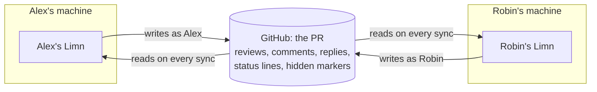
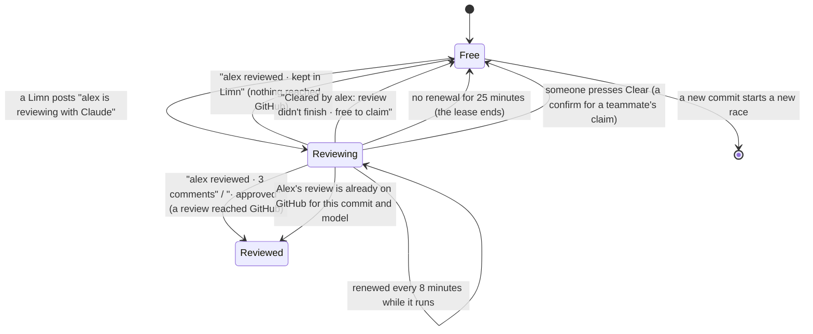
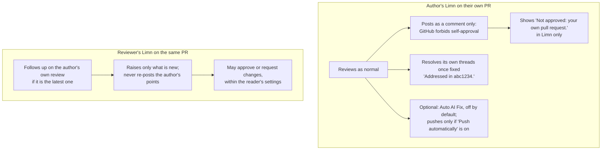
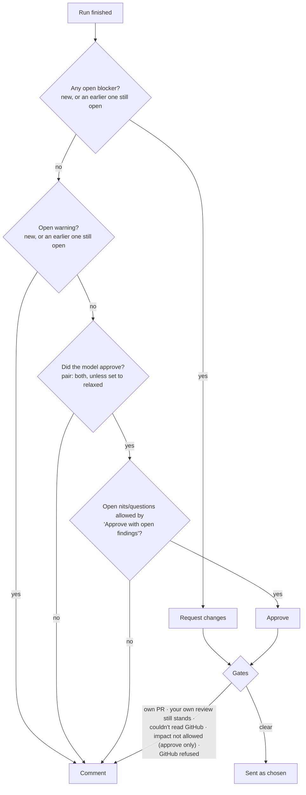
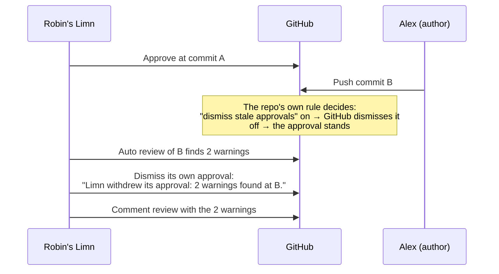
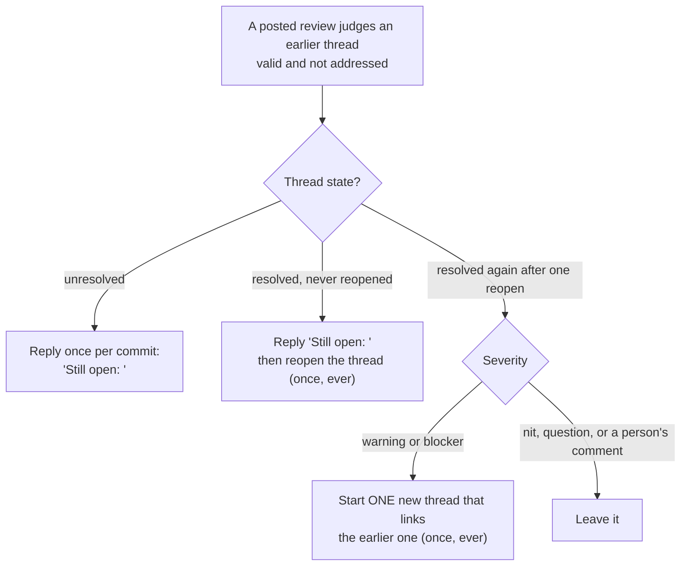
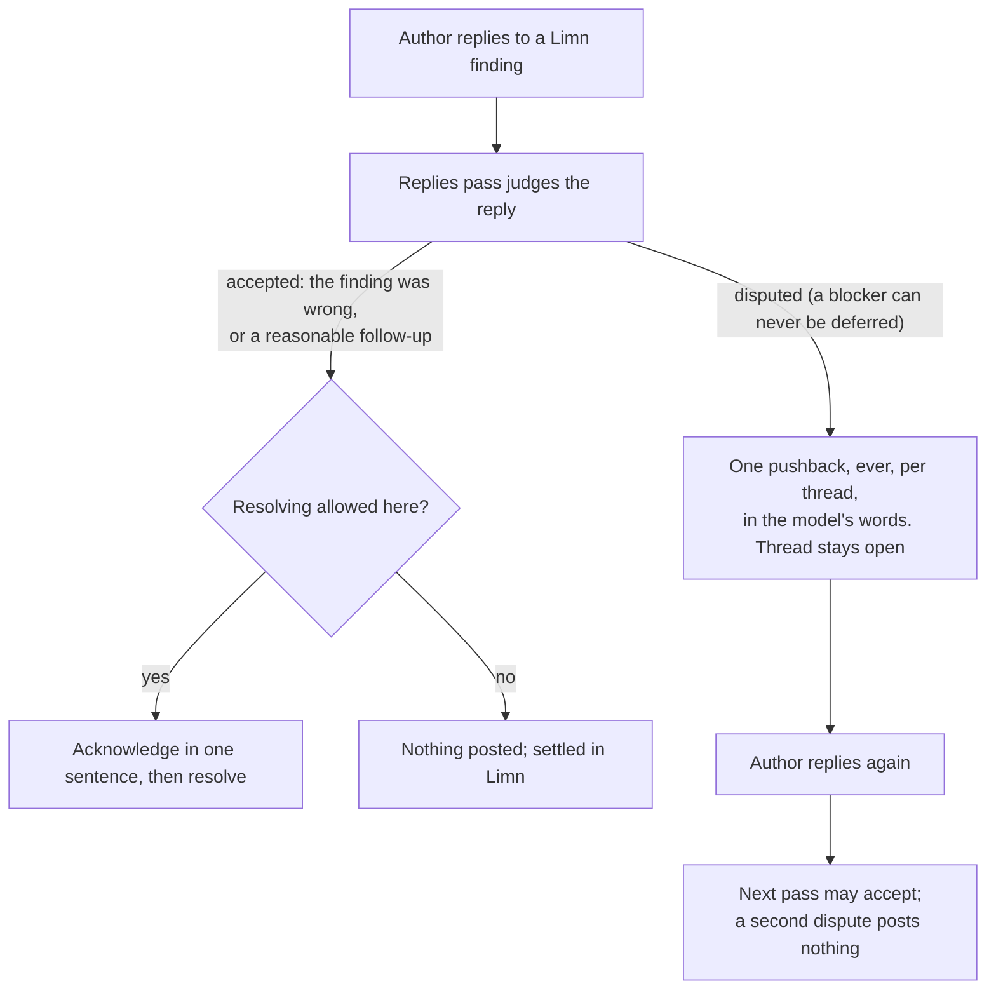

# Limn on a team: how shared reviews work

**Status:** the design reference for every multi-user behaviour. A shareable copy with drawn
diagrams lives in Claude Docs ("Limn on a team: how shared reviews work"); this file is the source. Checked against the code on
2026-11-05 (Limn 1.0.5). **Keep it true:** any change to claims, auto review, auto-posting, verdicts,
withdrawals, teammate reviews, thread judgements, replies, pushback, resolving or still-open points
updates this file in the same commit. Engineering detail (names, tables, markers) lives in
[CLAUDE-REVIEW.md](CLAUDE-REVIEW.md); this file says what happens and why, in plain words.

---

## 1. The idea in one page

Every person runs their own Limn on their own machine, signed in to GitHub as themselves. There is
no Limn server and no shared account. **GitHub is the only meeting place**: each Limn reads what
the others wrote there, and writes back only as its own person.

Three rules follow from that and explain most of what is below:

1. **A Limn only knows what reached GitHub.** A review someone "kept in Limn" is invisible to the team.
2. **Every write is a person's write ON GITHUB, and Limn's IN LIMN.** A Limn post is that person's
   review or comment on GitHub, so GitHub's own rules apply to it (an author cannot approve their own
   PR; branch rules decide what a push dismisses). Inside Limn it is the bot "Limn · alex", never
   alex: the owner's rule is "everything Limn does on my behalf is not me". Every row Limn wrote
   (a review, an approval, the empty review around a reply, a story check, a commit, a merge, a PR it
   opened) is stored under that bot, recognised by the hidden marker, the `Limn-Run:` commit trailer,
   or, on the machine that wrote it, Limn's own record of its writes ([CLAUDE-REVIEW.md](CLAUDE-REVIEW.md)
   § Limn's actions are bots). A teammate's Limn rows are found by the marker and the trailer only.
3. **Each Limn decides alone, from what it reads.** Nothing coordinates two machines except the
   status lines and markers they leave on GitHub, so every rule is written to be safe when two Limns
   act at nearly the same moment, and safe when a teammate runs an older version.

What travels between Limns:

| Signal on GitHub | What it tells another Limn |
|---|---|
| A **status line** on the PR's latest commit, one per model ("alex is reviewing with Claude", "alex reviewed · 3 comments", "Cleared by alex…") | Who is reviewing this commit with which model, and whether it is done. Never CI. |
| A **posted review** with a hidden marker at the end | That it is a Limn review; the commit it read; the model(s); the verdict sent; the Limn version; its judgement of earlier threads; whether the poster lets a teammate's Limn lift their "changes requested". |
| **Finding comments** with a severity word ("**Warning**") and a hidden marker | A Limn finding, raised by that person's Limn. Every Limn treats it as a bot ("Limn · alex"), never as the person. |
| A **`Limn-Run:` line** at the end of a commit message | A commit Limn made (AI Fix, a conflict resolution, Implement, a branch update). Every Limn treats it as the bot's, never the person's. |
| **"Still open:" replies** with a hidden marker | Which commit it was said at, and whether this thread has already been reopened once. |

What never travels: costs, settings, drafts, reviews kept in Limn, chat, and anything about the
reader's machine. (Code and diffs do go to the model provider the person chose; that is not shared
with teammates.)

---

## 2. Who is who

| Word | Meaning |
|---|---|
| **Author** | The person who opened the PR. GitHub never lets them approve it or request changes on it. |
| **Reviewer** | Anyone else on the team looking at the PR. |
| **Reader** | Whoever is looking at Limn right now. Each person is the reader on their own machine. |
| **Your Limn / Robin's Limn** | The Limn running for that person, posting as them. |
| **Model** | Claude or Codex. Each person signs in to their own; usage limits are per person. |
| **Pair** | A review where Claude and Codex both review blind and Limn merges them into one post. The default when both are signed in. |
| **Auto review** | A review Limn starts by itself. Off per workspace until switched on. |
| **Posting** | Sending a review to GitHub. Automatic runs post by default (the "Post to GitHub" setting); a run you start posts only with "Review and post". |

---

## 3. Sharing the review burden

**The rule: one review per model per commit, across the whole team.** If Robin's Limn reviews a
commit with Claude, nobody else's Limn reviews that commit with Claude. Another model is still
welcome: if Robin used Claude, Alex's Limn reviews with Codex only. If Robin ran both, Alex's runs
nothing. A new commit starts the race again.

Only **automatic** reviews claim. A review you start yourself never waits, never posts an "is
reviewing" line and is never refused. Two things still connect it to the team:

- When it starts, your AI Review tab names a teammate who is reviewing, or has reviewed, the same
  commit with the same model ("Robin Dunn is reviewing this commit with Claude"). Your run goes ahead.
- When you post it ("Review and post", or the Post button), your Limn writes the same "reviewed" line
  an automatic review writes ("alex reviewed · approved · 2 comments"). Teammates' automatic reviews
  then step aside for that model on that commit. It is not written over a teammate's newer line, or
  on your own PR.

Claims are **on by default**.

### When an automatic review starts

| Event | What Limn does |
|---|---|
| A person opens a PR (after auto review was switched on) | Reviews it on the next one-minute tick. |
| New commits | Reviews at once if nothing ran in the last 5 minutes; otherwise waits for 5 quiet minutes, never more than 20 minutes after the first push. A run in progress is never cancelled. |
| A reply on one of your Limn's posted findings | A short "replies pass" (§ 7), after 5 quiet minutes. At most 5 a day per PR. Also on a new commit a teammate's claim holds, so a reply after a push is not left waiting. |
| Another new comment in an unresolved thread, by a person or a review bot | A light "Check threads" pass. At most 30 a day per workspace. |
| A thread is resolved, CI finishes, a deploy or coverage bot comments, your own Limn posts | **Nothing.** Resolving adds no comment, so it starts nothing. |

Limits: 20 automatic reviews a day per workspace by default (a pair counts once; a skip because a
teammate has the commit counts nothing). A failed run is retried only when the error is temporary,
at most 3 tries per commit (after 1 hour, then 4 hours, or when the usage limit resets).

### How a claim works

- **Who wins a race:** each Limn posts its line, then reads the lines again. Of the claims that are
  still live (renewed in the last 25 minutes), the **earliest** wins. The loser stands down and shows
  the winner's name.
- **"Reviewed" means done:** the line turns to "reviewed" only after the review is posted. If a
  Limn's review reached GitHub but its final line never did (a crash, an old version), every other
  Limn treats that posted review as the "reviewed" line as soon as it syncs it, instead of waiting
  out the 25 minutes.
- **Free again:** a failure, a Stop, a skipped run ("Cleared by alex: auto review skipped · daily
  auto-review limit reached"), a review that put nothing on GitHub ("· kept in Limn"), the Clear
  button on a live claim, or a lease that ran out (another Limn then posts "Cleared by alex: bob's
  claim expired"). Every free line except "kept in Limn" starts "Cleared by", which older Limns also
  read as free. Limn never posts a red line.
- **"Kept in Limn" means nothing reached GitHub.** Any review that did is "reviewed" and holds the
  commit, with the verdict first: an approval with only nits (nits are not posted) reads "· approved";
  a reason-only comment, or a pair review that holds only the other model's findings, reads "· no
  comments". A review with nothing to say also reads "· no comments".
- **A late line is never posted blind.** Before a run's final line ("reviewed" or "didn't finish"),
  Limn reads the commit's lines. If a teammate has since reviewed the commit or holds a live claim (a
  laptop slept past the lease), the late line is not posted and the teammate's line stands.
- **Status lines are the one write Limn retries**: releasing a line, or a final line that failed, is
  retried up to 5 times. Everything else is written once.
- **The author never holds a commit for the reviewers.** Because the author cannot approve, their
  Limn's lines are ignored by everyone else's Limn. It does not work the other way: the author's own
  Limn still steps aside for a reviewer's claim (their review would only be a comment on their own PR).
- **If a claim cannot be read or written** (no write access, GitHub error), the review runs without
  a line. Claims never block a review outright.
- **Never make a `limn/` line a required check** in branch protection or a ruleset: a line still
  reading "reviewing" would block merges. Limn does not read branch rules, so it cannot warn per repo;
  the claims setting's ⓘ says "Don't make limn/ lines required checks." (gap 11).

### Pairs and usage limits

| Situation | What your Limn does |
|---|---|
| Robin has Claude on this commit | Runs Codex alone and claims Codex. |
| Robin has Codex | Runs Claude alone; your review says "Codex didn't finish: a teammate's Limn is reviewing with Codex". |
| Robin has both | Runs nothing: "Robin Dunn reviewed this commit with Claude · posted on GitHub". |
| Robin has Claude, and your Codex is at its usage limit | Runs nothing. A model at its limit is dropped before any claim. |
| Your Claude is at its limit, nobody has the commit | Runs Codex alone. With a pair, "Run auto reviews now" runs a locked model only when every model is locked; with one model, a press runs it anyway. |

### What you see when your Limn steps aside

- AI Review tab: "Robin Dunn is reviewing this commit with Claude", or "…reviewed this commit with
  Claude · 4 comments" (or "· approved", "· posted on GitHub"). A teammate's live claim has a Clear
  button, with a confirm. It is stored, so it is still there after Limn restarts, but only while the
  claim's 25-minute lease could still run. Clear reads the commit's lines on GitHub first and posts
  "Cleared by …" only if the newest line is still a claim: if the teammate has finished, it posts
  nothing and the button goes. If GitHub cannot be read, it posts nothing.
- Open PRs column: "Being reviewed by @robin" / "Reviewed by @robin".
- While a teammate's Limn is reviewing **now**, that line is in full ink with a pulsing AI sparkle beside it (still under reduced motion); "reviewed" lines stay quiet.
- No run is recorded, no daily allowance is spent. Your Limn looks again when the lease could end,
  every 30 minutes after a "reviewed", or at once on a new commit or when Robin's review syncs.
- On your own PR, Robin's posted review still closes your fixed Limn threads: see § 6 Resolving.
- **Your replies are still judged (2026-11-09).** When you reply on your own Limn's findings after a
  push and Robin's claim makes your Limn skip that commit, your Limn runs a **replies pass** at that
  commit instead (§ 7): the same 5-a-day cap per PR and the same spend budget. Robin keeps the review.

---

## 4. Author and reviewer

| | Author's Limn (own PR) | Reviewer's Limn |
|---|---|---|
| Can approve or request changes | **Never.** Always a comment. | Yes, within the settings (§ 5). |
| Holds the commit against others | **No** — other Limns ignore its lines. | Yes. |
| Steps aside for others | Yes, for a reviewer's claim on the same model. | Yes, for another reviewer's claim. |
| Resolves its own threads when fixed | Yes, on by default ("Resolve my Limn threads when addressed"), after any run. | Only with the workspace's "Resolve Limn's threads once fixed" (off by default), on automatic runs. |
| Auto AI Fix | Optional, off by default; at most 3 per PR a day; pushes only if "Push automatically" is on. | Never on someone else's PR. |
| Writes on the other's threads | Never resolves a teammate's thread. On its own PR, may post "Still open:" but never reopens a thread or starts a new one (decision D2). | Never resolves a teammate's thread. May post one "Still open:" reply per thread per commit and reopen a thread once, ever (§ 6). |

How the two Limns read each other:

- **A teammate's posted review is imported** into your Limn as their review — read-only, attributed
  to them. Findings show who raised them ("You", "Robin", "You and Robin"); the same point found by
  both shows once. You cannot reword or ignore their finding; the one write offered is **Post
  reminder**, which posts the point again as you.
- **The reviewer follows up on the author's own review** when it is the latest review: the author's
  points are checked like earlier findings, and nothing they raised is posted again.
- **A teammate's review is followed up** while their "changes requested" still stands on GitHub.
- **Own PR** means the PR's author login is yours. PRs opened by bots get no auto review and no
  automatic posting (a "Review and post" you press still posts). Drafts get no auto review, no
  automatic posting and no still-open writes; "Resolve my Limn threads" does act on your own drafts.
- **The author's own threads still close when a reviewer has the commit.** The author's Limn steps
  aside, but it reads the reviewer's posted review: each of the author's Limn findings that review
  found addressed at the PR's latest commit is resolved by the author's Limn (§ 6 Resolving). The
  reviewer's Limn still never resolves a teammate's thread.
- **Teammates' Limn posts wake your Limn.** A teammate's Limn findings count as review-bot comments,
  so a new teammate review can start a Check threads pass on every other Limn (within the 30 a day).

---

## 5. Verdicts and approvals

Automatic posts use the reader's settings. With **"Approve or request changes for me"** on (the
default), the posted verdict is chosen like this:

- **Earlier points count too** (decision D1). If the review judges an earlier point still open and
  knows its severity, it counts like a new finding: an earlier blocker means "request changes", an
  earlier warning stops an approval, and earlier nits and questions follow "Approve with open
  findings". The severity is known for Limn findings (yours or a teammate's Limn), reminders
  included. A person's comment
  has no severity, so it never stops an approval; it is named in the "Not approved" line only.
- **Your own standing review wins.** If you approved or requested changes by hand, Limn never
  overrides it; it posts a comment. Limn's own earlier automatic verdict does not count as yours.
- **Impact:** an approval can be limited by the PR's impact level (all levels allowed by default;
  unknown impact counts as High). Requesting changes is never limited by impact.
- **One post per run**, recorded before writing, never retried. If GitHub refuses the verdict, the
  same review goes once more as a plain comment.
- **What is posted by default:** blockers, warnings, questions, CI failures, story gaps and
  SonarCloud results. Nits are not. Nothing already on GitHub is posted again.
- **The replies pass can change the verdict** (§ 7): a disputed blocker can turn into "request
  changes"; once everything is settled it can approve, through the same gates.
- **Which PRs:** by default "mine" — your own PRs, PRs you are or were asked to review, or PRs you
  already reviewed or commented on. A request to a GitHub team does not count.

### The "Not approved" line

When the verdict is not an approval, the review ends with one line saying why. The first match wins:

| Situation | Line |
|---|---|
| Blockers or warnings open, new or earlier | "Not approved: 2 warnings are still open." · "Not approved: 1 earlier warning is still open." · "Not approved: a blocker and 2 earlier warnings are still open." |
| A pair whose Codex (or Claude) half failed: the other checked its earlier warnings first | "Not approved: 2 earlier Codex points are still open." · "Not approved: 1 earlier Codex point was not checked." (the check failed or was skipped) |
| A model asked for changes | "Not approved: Codex asked for changes. <its first sentence>" |
| A model only commented, something open | "Not approved: Claude did not approve. A nit is still open." (or "1 earlier point is still open." / "A ticket criterion is still unmet.") |
| Pair, neither approved | "Not approved: neither Claude nor Codex approved. No findings are open." |
| Leftovers not allowed | "Not approved: a question is still open." (or "1 earlier question is still open.") |
| Gates | "your own pull request." · "your own review on GitHub still stands." · "the earlier request for changes still stands." · "High impact." · "couldn't read the earlier reviews on GitHub." · "GitHub refused it." |

A single model that only commented while NOTHING is open (no finding, no earlier point, no unmet
ticket criterion) is treated as an approval: it still goes through the impact, own-PR and
standing-review gates, and a held one says why. A Claude + Codex pair is never promoted this way:
its own strict / relaxed rule decides. The line never calls the verdict "a comment" (Limn 1.0.14
on; older Limns still post "left a comment, not an approval").

The own-PR, own-review, couldn't-read and refused reasons show in Limn only. If a review has nothing
else to post, the line goes out alone as one short comment, at most once per PR and commit — but
never while you still have an open review request on the PR (any review would answer the request).

**A review may not claim an open point it never recorded.** If Limn records nothing as still open,
any sentence in the summary claiming one is removed before posting.

### When Limn takes its approval back

- **A push alone never makes Limn withdraw anything** (since 1.0.1). Each repo's own branch rule or
  ruleset decides, per branch, and GitHub does the dismissing.
- **A later review that does not approve** withdraws Limn's earlier automatic approval first, once:
  an automatic run, or "Review and post". This happens even when "When an auto review finishes" is
  "Keep it in Limn": the approval is Limn's own earlier write, so Limn corrects it and posts nothing
  else. A "Review only" run never writes. A run at the same commit never withdraws.
- **Never touched:** an approval you gave by hand, one you sent with the Post button, or anyone
  else's approval.
- **How Limn reads a dismissal:** a reviewer's newest verdict-type review decides their standing,
  and a dismissed one counts as nothing. "Changes requested → approved → approval dismissed" reads
  as no verdict, matching GitHub's "review required" (since 1.0.2).
- **A withdrawn approval is never lost** (1.0.14). Limn reads each dismissal from the PR timeline:
  when, who and the message. "Where this PR stands" keeps one note on the person's row even after
  their later Comment: "Robin · Comment · 9 Nov · 951c4aa · approval from 9 Nov withdrawn: 3 warnings
  found at 951c4aa". "Reviews on this PR" keeps the review as "Approve (withdrawn)". The verdict is
  the one Limn's hidden marker says it posted; a review from an older Limn without it reads
  "Withdrawn".
- **A replies check's Approve or Request changes shows** in "Reviews on this PR" ("Approve · 9 Nov ·
  7f8ea89 · Replies checked"). A teammate's is a row of its own, with a link to GitHub; a Comment
  outcome is never listed.
- **A replies check does not approve over another Limn.** If a teammate's Limn review, posted after
  the review the check rests on, still judged one of the settled points open, the approval is held
  and one short comment says why: "Not approved: robin-dunn’s Limn judged a point still open." 

### Lifting "changes requested"

- **Your own Limn's block** is lifted by your next run that finds no blocker: an approval replaces
  it, or it is dismissed with "Claude's blocking findings are fixed." No setting needed.
- **A teammate's Limn block** is lifted only with consent from both people (both off by default).
  Consent rides each post made after ticking; a post sent with the Post button never carries it.

| Robin ticks | Alex ticks | Then |
|---|---|---|
| "Let a teammate's Limn dismiss my Limn's 'changes requested' once every point is fixed" | "Dismiss a teammate's Limn 'changes requested' once every point is fixed" | When Alex's run at the PR's latest commit finds every point behind Robin's block fixed and no blocker of its own, Alex's Limn posts its review, then dismisses Robin's block: "Limn (alex) checked all 3 points are addressed at 70cc9b5." Once, never retried. |

Never dismissed by this: any approval, a review typed by hand, a review sent with the Post button.

---

## 6. Threads: checking earlier comments

### What Limn knows about a thread

| State | Meaning |
|---|---|
| Resolved | GitHub says so. |
| Likely addressed | A commit touched the file after the last comment, or GitHub marked it outdated. **A guess**, and shown as one. |
| Replied | Someone other than the opener replied, with no later change. |
| Untouched | No reply, no later change. |

Once a Limn review has judged a thread, its card shows that judgement instead: two pills for a
comment ("Holds up / Partly / Doesn't hold" and "Addressed / Partly addressed / Open"), or one
outcome pill for a Limn finding ("Not addressed"). Newest judgement wins. No Limn reply ("Still
open:", a pushback, an acknowledgement, a resolve reply) counts as a reply.

**Newest judgement wins, whoever's Limn made it (2026-11-09).** On a thread of your own Limn's finding,
a teammate's Limn that judged it after your Limn did replaces your pill, and the pill names it:
"Robin's Limn: addressed". The line under the pill is the one-line **how**: how it was dealt with, or
the one thing still needed. Your own resolve changes no judgement: a finding your Limn still finds not
addressed reads "Not addressed · Resolved", with what is still needed under it.

### How a later review judges earlier comments

- **Your own Limn's findings** get a follow-up: addressed, partly addressed, not addressed, no longer
  applies, reply accepted, reply disputed — or "not checked", carried to the next review. Limn never
  invents "addressed". Partly / not addressed / disputed are raised again, linked to the original.
- **Everyone else's comments** (a teammate's Limn, a person, another review bot) get two answers:
  is the point valid, and is it addressed. Resolved threads are judged too — resolving is only a click.
- The posted review's hidden marker carries its judgements of **Limn findings** (addressed, not
  addressed, no longer applies, still open) and "still open" on any other thread — at most 50. Whether
  a person's point "holds up" is never shared; teammates see only the "Still open:" replies.
- **Every judgement has a one-line how** (≤ 120 characters): addressed → how it was dealt with; not or
  partly addressed → the one thing still needed; reply accepted → why. The marker carries it too
  (`jr=`, 2026-11-09), so a teammate's Limn can say how when it resolves your thread. A Limn from
  before it ignores the extra key.

### Still-open points: every open point has a place

A review that thinks an earlier point is still open must say **where**, on GitHub, so the author can act.

On **the reader's own PR** (decision D2) Limn never reopens a thread and never starts a new one. It
only replies: once per commit on an open thread, and once, ever, on a resolved thread.

**A thread YOU resolved (decision D4, 2026-11-09):** Limn writes nothing there by itself — your resolve
is your decision. Limn shows "Not addressed · Resolved" and what is still needed, in Limn only. The
follow-up row offers **Post still open** to post that line yourself (once per commit).

- Written only when the review is posted (automatic with posting on, or "Review and post"), and only
  if the PR has not moved past the reviewed commit. Never on another review bot's thread.
- "Once" is known to every Limn: the hidden marker on the reply records the commit and the reopen.
  Every write is recorded before it happens and never retried.
- **Just before writing, Limn reads the thread on GitHub again.** If another Limn has replied at this
  commit, reopened the thread or started a new one since the last sync, Limn writes nothing. If the
  read fails, Limn writes nothing on that thread at that commit and records why.
- **A disputed reply:** on an open thread, the one pushback (§ 7) says it, so nothing more is posted.
  On a resolved thread (where pushback never goes), Limn treats it like any other open point.
- **A new thread replaces the old one.** Later reviews judge the new thread, not the old one, and
  the author's card and list point to it. A new thread is never followed by another new thread. (A
  Limn before 1.0.5 could do that; a later review then gets every earlier thread of the chain, oldest
  first, with the newest one.)
- **What the author sees:** a "Robin's Limn: still open" pill on the thread, a "Still open (N)" list
  in the Overview's AI review card, and a My Turn card "Robin's Limn: still open on src/x.ts" while the
  thread is unresolved, until they reply, push or resolve. (Needs AI on in the author's Limn.)

### Resolving

Limn resolves **only its own reader's Limn findings**, never a teammate's or a person's thread:

| Setting | Default | When | Reply |
|---|---|---|---|
| "Resolve my Limn threads when addressed" | On | Your own PR, after any of your runs | "Addressed in abc1234: \<how\>" / "No longer applies as of abc1234: \<how\>" — "_Resolved by Limn's Claude review._" |
| (the same setting) | On | Your own PR, open, when a teammate's posted review found your Limn finding addressed or no longer applies **at the PR's latest commit**, and no run of yours at that commit is newer | "Addressed in abc1234 (checked by Robin's Limn): \<how\>" — "_Resolved by Limn._" |
| "Resolve Limn's threads once fixed" | Off | Any PR, automatic runs with posting on | Same wording, with the automatic-post footer |

With no how (a run, or a teammate's Limn, from before it) the reply ends after the commit, as before.

**A thread someone already resolved** gets ONE reply with the how — "Addressed in abc1234: \<how\>",
no resolve — and only when no Limn reply follows the person's last comment there. So everyone sees how
it was fixed, without repeat replies.

The teammate row is how your fixed threads close while your Limn steps aside (§ 3). Your Limn acts
on the teammate's word only when it is the newest word at that commit: a later "still open" from any
teammate keeps the thread open. Each thread is recorded before the write and never retried. In your
AI Review tab the finding reads "Resolved automatically (checked by robin's Limn)".

**Only a trusted reviewer's word closes a thread.** Anyone who can post a review can type Limn's hidden
marker, so your Limn acts on an "addressed" or "no longer applies" word only when the reviewer is a
person (not a bot) and GitHub says, when Limn asks just before writing, that they have write access to
the repo. Otherwise, or if GitHub cannot be read, nothing is written and Limn logs whose word it ignored.
The review still shows in the AI Review tab. A "still open" word needs no check: it only keeps a thread
open.

---

## 7. Replies and pushback

When the author answers one of your Limn's findings, your Limn judges the reply without waiting for a
full review: the **replies pass**. It starts after 5 quiet minutes (automatic, at most 5 a day per
PR, within the spend budget) or when you press "Check replies". It is cheap (a smaller model, a hard
cost cap) and never runs while a full review is running.

- **What counts as a person's answer:** a reply with text by a person, without any Limn marker.
- **An accepted reply settles the finding for good**: it is never raised again. Its acknowledgement
  goes out only as the resolve reply, so on a teammate's PR with "Resolve Limn's threads once fixed"
  off (the default) nothing is posted. The acknowledgement and pushback are the model's own sentence;
  the fallbacks are "Thanks for explaining. That makes sense." and "Thanks for the reply. I still
  think this needs changing in this pull request."
- **Pushback** goes only on automatic runs with posting on, on an unresolved thread, from your
  account, once per thread ever. A disputed reply on a resolved thread gets a "Still open:" reply
  instead (§ 6). Limn never resolves after a pushback. Manual runs show a draft with
  "Post reply" instead.

---

## 8. Whose turn is it?

| Thing | Waits on | Ends when |
|---|---|---|
| An unanswered review thread | **The PR author** — never the person who opened it | The author replies, pushes a fix, or resolves |
| A still-open point | The PR author | Same, judged at the current commit |
| An outstanding review request | The requested reviewer | They review **in person**. A review only their Limn posted removes the request on GitHub, but Limn keeps it in their My Turn |
| A Limn finding, reminder, "Still open:" reply, pushback, acknowledgement or resolve reply | Nobody — stored as "Limn · alex", never as the person | — |
| A teammate's reply to your Limn's finding | Nobody — the thread is Limn's, not yours, unless you replied in it yourself | — |

Any reply with Limn's hidden marker is stored as "Limn · alex" (a "Post reply" you press too: the
words are Limn's draft). It never ends a thread card, never raises a "reply in a thread you
commented in" card, never makes a thread "Replied", and never starts another Limn's review.
Replies stored before 1.0.5 are moved to the bot on the next start or sync.

Your turn counts only what you did yourself. Limn's reviews, comments, pushes and merges for you
never count as "your last action", so a PR only your Limn touched is never your turn. Two things are
about the PR, not an action, and still count: a PR your Limn opened for you (Implement, AI Fix on a
new branch) is one of "Your PRs", and a review request only your Limn answered still waits on you.

The Slack digest and the Pending board word threads this way: "Comment on src/x.ts waiting on the
author"; "Alex's comment on package.json has no reply · waiting on Robin".

---

## 9. Worked examples

All names and times are illustrative; every step follows the current rules.

### 9.1 Two reviewers share a new PR
1. 09:00 Carol opens PR #12. Alex and Bob both have auto review on (Claude + Codex).
2. 09:01 Alex's Limn finds no lines, posts "alex is reviewing with Claude" and "…with Codex", and starts.
3. 09:03 Bob's Limn sees both live claims and steps aside: "Alex is reviewing this commit with Claude". No allowance spent.
4. 09:14 Alex's pair posts one review; lines become "alex reviewed · 3 comments" / "· 2 comments".
5. 09:15 Bob's Limn imports Alex's review. Bob's AI Review tab shows Alex's review with each finding marked "Alex".

### 9.2 A race splits the pair
1. 10:00 Dana pushes commit B. Alex's Limn and Bob's Limn both treat it as due.
2. 10:01:10.2 Alex claims Claude; 10:01:10.8 Bob claims Claude. Alex's line is earlier: Bob stands down on Claude.
3. Bob's Limn claims Codex before Alex's Codex half does, and runs Codex alone.
4. Alex's review says "Codex didn't finish: a teammate's Limn is reviewing with Codex". The commit gets one Claude review (Alex) and one Codex review (Bob). Nothing is duplicated.

### 9.3 A laptop closes mid-review
1. 15:00 Bob's Limn claims commit C; 15:08 renews; 15:10 Bob closes his laptop.
2. 15:02 Alex's Limn steps aside, and checks again at 15:25:30 — Bob's 15:08 renewal is still live.
3. 15:34 Bob's lease has run out. Alex's Limn claims and reviews.
4. If instead Bob's review had reached GitHub but his final line had not, Alex's Limn would treat it as reviewed as soon as it synced it — no 25-minute wait.

### 9.4 The author reviews first, then a reviewer
1. 10:00 Carol opens #10; her own Limn reviews and posts a comment with 2 warnings, ending "Not approved: 2 warnings are still open." (Had it wanted to approve, "Not approved: your own pull request." would show in her Limn only.)
2. Alex's Limn ignores Carol's claim (she is the author) and reviews, following up on Carol's 2 warnings. It finds one new nit, which is not posted; on each of Carol's two open warning threads it replies "**Still open:** …". Carol's warnings are still open, so it does not approve: "Not approved: 2 earlier warnings are still open."
3. Carol pushes a fix. Alex's Limn claims the new commit first; Carol's Limn steps aside.
4. Alex's run judges both warnings addressed; with no blocker or warning open and the impact allowed, Alex's Limn approves. Its review records both judgements.
5. Carol's Limn syncs Alex's review. Both warnings were found addressed at the latest commit, so Carol's Limn resolves her two threads: "Addressed in 1234abc (checked by Alex's Limn)." Carol does nothing.

### 9.5 Your PR, a teammate on Claude, your Codex at its limit
1. Robin's Limn reviews your commit with Claude and posts.
2. Your Limn would run Codex, but Codex is at its usage limit until Monday. It runs nothing.
3. You see Robin's review in your AI Review tab. When the limit lifts, your Limn looks again within 30 minutes and runs Codex on the current commit, since Claude still reads as reviewed by Robin.

### 9.6 Approval, push, and GitHub's rule
1. Robin's Limn approves your PR at commit A.
2. You push commit B. Your repo keeps approvals after a push, so the approval stands. (In a repo that dismisses stale approvals, GitHub dismisses it.)
3. Robin's Limn reviews B and finds 2 warnings. It withdraws its own approval ("Limn withdrew its approval: 2 warnings found at B."), then posts a comment with the warnings.
4. Your header shows Robin's standing as dismissed, which counts as nothing, and GitHub's "review required".
5. Had Robin's workspace been set to "Keep it in Limn", step 3 would still withdraw the approval with the same message; the warnings would stay in Robin's Limn.

### 9.7 Pushback, then agreement
1. Alex's Limn posts a warning on Bob's PR: "this can be null".
2. Bob replies: "Can't be null; upstream validates."
3. Five quiet minutes later Alex's replies pass disputes it and posts one pushback from Alex's account. The thread stays open.
4. Bob replies with a link to the upstream check. The next pass accepts. If Alex's workspace has "Resolve Limn's threads once fixed" on, Alex's Limn posts a one-sentence acknowledgement and resolves the thread; with it off (the default) nothing is posted and the finding is settled in Alex's Limn.
5. Had it disputed again, Limn would post nothing more; the point would be raised again in the next full review.

### 9.8 Resolved too early: reopen once, then a new thread
1. Robin's Limn posts a warning on Bob's PR. Bob resolves it without fixing anything.
2. Alex's automatic review (posting on) at commit H1 judges it valid and not addressed: it replies "**Still open:** the null check is still missing in parse()" and reopens the thread. With Robin's warning still open, Alex's review does not approve.
3. While it is open, Bob's My Turn shows "Alex's Limn: still open on src/parse.ts". Bob resolves it again.
4. Robin's review at H2 sees the thread was reopened once already. It is a warning, so it starts one new thread that links the old one. Alex's Limn sees that and does nothing more. (Had Alex's Limn acted at H2 at the same moment, its read of GitHub just before writing would have seen Robin's new thread first.)
5. Bob's My Turn card and the Overview's "Still open" list now point to the new thread. Later reviews judge the new thread, not the old one. If Bob resolves the new thread too, it is reopened once more, and then left alone.

### 9.9 A teammate's block is lifted
1. Carol's Limn requests changes on Bob's PR (1 blocker, 1 warning). Carol has ticked "Let a teammate's Limn dismiss my Limn's 'changes requested'…".
2. Bob fixes both. Alex has ticked "Dismiss a teammate's Limn 'changes requested'…".
3. Alex's run at Bob's latest commit judges both points fixed and finds no blocker. It posts Alex's review, then dismisses Carol's block: "Limn (alex) checked all 2 points are addressed at 70cc9b5."
4. Without Carol's tick, her block stays; Alex's approval could still go out.

### 9.10 A person's question
1. Carol asks a question on Bob's PR. Alex's posted review judges it valid and not addressed and replies "**Still open:** …".
2. The thread still reads as untouched (a Limn reply is not a reply). Bob gets "Alex's Limn: still open" in My Turn.
3. If Bob resolves it and it is reopened once and resolved again, it is left alone: a person's comment has no severity, so no new thread.
4. For the same reason the open question does not stop Alex's approval; the "Not approved" line, if any, names it as "1 earlier point is still open."

### 9.11 A manual review holds the commit
1. 11:00 Dana pushes commit D. Alex presses Review on Dana's PR. Bob's automatic review claimed D with Claude at 10:59.
2. Alex's run starts at once. His AI Review tab says "Bob is reviewing this commit with Claude".
3. 11:12 Bob's Limn posts an approval with 2 nits, which are not posted. Its line reads "bob reviewed · approved", so Carol's Limn steps aside on Claude.
4. Alex posts his own review with the Post button. Bob's line is newer, so Alex's Limn writes no line for Claude.
5. On commit E, nobody's Limn has claimed Codex when Alex posts a Codex review by hand. His Limn writes "alex reviewed · 1 comment" for Codex, and Bob's and Carol's automatic runs review E with Claude only.

---

## 10. What Limn never does

- Approve or request changes on the reader's own PR.
- Override a review the reader gave by hand, or anything sent with the Post button.
- Withdraw an approval because of a push alone.
- Dismiss anyone's approval to lift a block; dismiss a review typed by hand.
- Edit or delete a teammate's comment, or resolve a teammate's or a person's thread.
- Reopen a thread more than once, or post more than one pushback per thread.
- Reopen a thread, or start a new thread about an open point, on the reader's own PR.
- Retry a GitHub write that failed — except its own status lines (up to 5 tries) and a refused
  verdict, which is sent once more as a plain comment.
- Treat its findings, reminders or any of its replies as a person's reply.
- Count its `limn/` status lines as CI.
- Show a teammate anything that was kept in Limn.

---

## 11. Settings that shape team behaviour

All are per workspace, in Settings → Auto review, except where noted.

| Setting | Default | Effect |
|---|---|---|
| Review new PRs automatically | Off | Reviews PRs a person opens after it is switched on. |
| Auto reviews a day | 20 | Daily cap (1–500). |
| Auto reviews use | Claude + Codex when both signed in | One merged review. |
| When Claude and Codex disagree | Strict | Strict: both must approve. Relaxed: one approves, neither asks for changes. |
| Mark auto reviews on GitHub (claims) | On | Status lines; the team shares the work per model. |
| When an auto review finishes | Post to GitHub | Or keep it in Limn (invisible to teammates). Limn still withdraws its own earlier automatic approval when a later run does not approve. |
| Which PRs | Mine | Or every PR. |
| What to post | Blockers, warnings, questions, CI failures, story gaps, SonarCloud | Nits and "not asked for" off. |
| Approve or request changes for me | On | Off means every post is a comment. |
| Approve at High / Medium / Low impact | All on | An unticked level gets a comment. |
| Approve with open findings | Nits and questions | Or nits only, or nothing. |
| Resolve Limn's threads once fixed | Off | Any PR, automatic runs with posting on. |
| Resolve my Limn threads when addressed | On | Your own PRs, any run. |
| Let a teammate's Limn dismiss my Limn's "changes requested"… | Off | Consent on the blocked side. |
| Dismiss a teammate's Limn "changes requested"… | Off | The lifting side. |
| Auto AI Fix on your own PRs / Push automatically | Off / Off | Fix after an auto review; push only if allowed. |

---

## 12. Mixed versions

Every rule is written so an older Limn on the team stays safe, but older Limns behave as they did:

| A teammate on… | Still does |
|---|---|
| before 1.0.14 | **Verdicts:** posts "Not approved: Claude left a comment, not an approval. No findings are open." when its model only commented with nothing open (a newer Limn approves through the gates); says "No findings are open." beside an unmet ticket criterion; a replies check approves even when a teammate's newer Limn review still holds a settled point open. **Team:** loses a withdrawn approval once a later Comment replaces it; never lists a replies check's verdict. |
| before 1.0.1 | Withdraws its own automatic approval on every push while its "Withdraw Limn's approval when new commits are pushed" setting is on — the default (0.1.182–1.0.0); waits out the 25-minute lease even when a review is already posted. |
| before 1.0.2 | Shows a reviewer as "requested changes" after their later approval was dismissed. |
| before 1.0.3 | Writes no "Still open:" replies, never reopens, may claim an open point it never recorded. Reads a new "still open" judgement as "not addressed". |
| before 1.0.5 | **Verdicts:** approves while an earlier warning or blocker is still open (D1); does not withdraw its own automatic approval when set to "Keep it in Limn". **Still open:** reopens threads and starts new ones on its own PR (D2); writes "Still open:" without reading GitHub first; posts nothing on a resolved thread whose reply it disputes; keeps judging the old thread after a new one continues it. **Claims:** writes "kept in Limn" when an approval or a reason-only comment did reach GitHub, so the commit is reviewed again; a manual review it posts writes no "reviewed" line; posts a late final line without reading first; loses the Clear button for a teammate's claim on restart. **Team:** shows no "update" line for a teammate on an old Limn; on its own machine, stores Limn's pushbacks, acknowledgements and resolve replies as the person (a newer Limn stores that teammate's as their Limn); leaves its own fixed Limn threads open on your PR while your Limn has the commit (it never reads your review's judgements). Its writes stay safe for newer Limns: they read its markers. |
| before 0.1.181 | Writes no thread judgements or lift consent. |
| before 0.1.175 | Shows no teammates' reviews at all, and lets the PR author's claim hold the commit. |
| before 0.1.174 | Reads a teammate's "kept in Limn" line as reviewed and stands down. |

The Limn version rides every posted review's marker. When a teammate's newest review on a PR came
from a Limn older than 1.0.5 (the team minimum, one shared constant), the AI Review tab shows one line
beside "Where this PR stands": "Robin is on Limn 0.1.188 — update for still-open replies and claim
fixes." A review with no version (a legacy post) reads "an older Limn". Nothing else acts on the
version.

---

## 13. Known gaps and decisions

### Decided

| # | Decision | Where |
|---|---|---|
| D1 | An earlier warning or blocker that a review judges still open stops an approval, like a new one; an earlier blocker means "request changes". | § 5 |
| D2 | On the reader's own PR, Limn never reopens a thread and never starts a new one; it may only reply "Still open:". | § 6 |
| D4 | A thread the reader resolved is the reader's decision (2026-11-09): a "not addressed" judgement there posts nothing by itself (Limn shows what is still needed; "Post still open" posts it); an "addressed" one posts its how once, only when no Limn reply follows the person's last comment. | § 6 |
| D5 | Newest judgement wins on the thread pill (2026-11-09), your Limn's or a teammate's, labelled with who made it. | § 6 |
| D3 | Limn's actions never count as the person (2026-11-08): a reply to your Limn's finding does not summon you; a PR your Limn opened is still yours; a request only your Limn answered still stands. Chronology shows two views, "People" and "People + bots", so Limn's effect on the waits is visible. | § 8 |

### Gaps that remain

Confirmed in the code on 2026-11-05. Each is a candidate for the next change; update this list when one is settled. There are no open decisions.

| # | Gap | Effect |
|---|---|---|
| 9 | Two teammates pointing their Slack digest at one channel. | Both post: each Limn sends its own. Guidance only — Settings → Slack says "Only one person per channel should set this up". |
| 11 | A `limn/` status line made a required check in branch protection. | An unfinished line would block merges. Guidance only — Limn does not read branch rules; the claims setting's ⓘ says not to. |
| 14 | You post a manual review while a teammate's automatic run holds a live claim on that model, so your Limn writes no "reviewed" line; then the teammate's run fails. | Nothing marks the commit as reviewed for that model, so a third teammate's Limn may review it again. |
| 15 | A finding whose point moved to a new thread (§ 6). | Its jump-to-thread link in the AI Review tab still opens the original thread, not the new one. |
